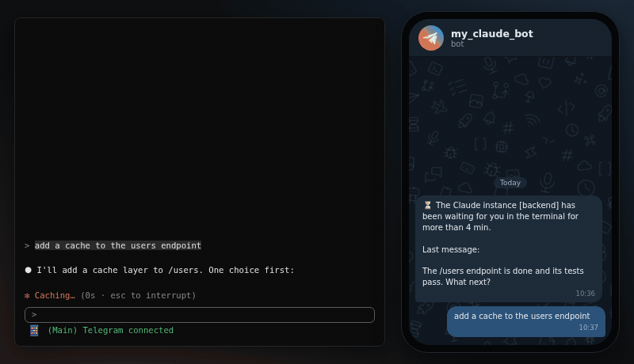
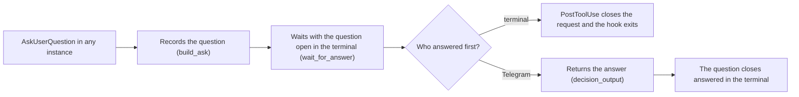

<p align="right"><sub><a href="README.pt-br.md">Português</a></sub></p>

<div align="center">


# better-claude-code-telegram

[](https://github.com/pedromondek/better-claude-code-telegram/actions/workflows/ci.yml)
[](https://www.npmjs.com/package/@pedromondek/better-claude-code-telegram)
[](LICENSE)
[](https://docs.anthropic.com/en/docs/claude-code)
[](#-requirements)
[](#-requirements)
[](docs/windows/windows.md)

</div>

Telegram for Claude Code, built on the [official Telegram channel plugin](https://github.com/anthropics/claude-plugins-official/tree/main/external_plugins/telegram). Each user connects Claude Code to a bot of their own. When Claude waits on you in the terminal longer than the delay you chose, its last message, the `AskUserQuestion` question and the permission request go to Telegram, and you answer there. An `AskUserQuestion` answer given on Telegram reaches the terminal as if you had picked it there.

It makes you more productive. Questions get answered sooner, so sessions stop less; you spend your time on the decisions instead of watching the terminal; planning gets better, especially with the illustrations on; and several sessions at once become easy to follow. In daily use, Claude also asked noticeably more questions, which lowers the chance of a wrong decision it would otherwise make on its own.

<p align="center"></p>

What it adds to the official plugin:

- `AskUserQuestion` mirrored with buttons (single choice, multiple choice and a typed "other" answer), answered from Telegram or from the terminal, whichever comes first.
- A notice with Claude's last message when it waits on you, a notice when a turn stops on an error (usage limit, authentication, billing), and permission requests held back while you are active in the terminal.
- Every Claude Code instance on the machine reaches Telegram through the one bot, labeled with the instance name.
- Claude illustrates on Telegram, when you turn it on: screenshots and videos of the real app, and diagrams sent as images. It costs more tokens.
- Nothing is cut: a long message goes on in follow-up messages, and tables, bold and code are formatted for Telegram, a table as aligned columns.
- Quiet hours, local voice transcription with `faster-whisper` and an optional status line indicator.
- Messages to the user in English and Brazilian Portuguese, chosen in the setup.

Every feature, with the demos, is in [Features](docs/features/features.md).

Plain `claude` keeps working as before. Only the instance opened with `claude --telegram` talks to the bot, and the other instances on the machine reach Telegram through it while it is open.

## ❓ FAQ

<details>
<summary>Show the questions</summary>

<details>
<summary><b>Why not just use Remote Control?</b></summary>

1. **Telegram's own messaging tools:** buttons, replies, voice messages, files and notifications that work like any chat.
2. **Only you:** Remote Control and its app notifications serve everyone signed in to the account, so on a shared account everyone sees and answers. Here the bot talks only to your paired Telegram account.

</details>

<details>
<summary><b>Why not just use the official Telegram channel?</b></summary>

Some Claude Code events are not well integrated there. An `AskUserQuestion` stops the whole session until someone answers it in the terminal, and it never reaches Telegram. That is the main problem this project was created to solve.

</details>

<details>
<summary><b>Do my messages go through a server of yours?</b></summary>

No. This project has no server: everything runs on your machine, and the messages go only between it and Telegram, through your own bot.

</details>

<details>
<summary><b>Does it work with the computer off?</b></summary>

No. The bot lives inside the `claude --telegram` session on your machine: with the machine asleep or the session closed, nothing reaches Telegram.

</details>

<details>
<summary><b>Does it use more tokens?</b></summary>

Some increase is expected. The questions, the buttons and the notices go through the hooks and the `bcct` binary, without a turn of Claude; your answers and Claude's replies on Telegram are ordinary messages; screenshots and videos cost the most, and they stay off unless you turn them on. In return, you gain the productivity described at the top.

</details>

<details>
<summary><b>Will it support the other channels too (e.g. Discord)?</b></summary>

Not planned. Telegram has a very wide range of what a bot can do, is easy to reach and to use, and gives you control over your account's security (two-step verification, active sessions) and a bot restricted to you.

</details>

<details>
<summary><b>Will it support other coding agents (e.g. Codex)?</b></summary>

Not planned. Claude Code is the tool I use every day, so that is where my focus is. If I come to use other coding agents, it may happen.

</details>

</details>

## 🔒 Safe by default

- The bot token is asked without echoing it and saved readable only by you, and a deny rule keeps Claude Code from reading that file directly (it does not cover a `grep -r` or a script).
- Only your paired Telegram account talks to the bot.
- The `bcct` binary is checked against the `checksums.txt` the release records before it is installed.
- Every release binary is attested by the workflow that built it (`gh attestation verify`) and published in an immutable GitHub Release, checked again after publishing.
- The npm packages are published from this repository through trusted publishing, with npm provenance, except the first version of each package, staged with the maintainer's login, since npm trusts a publisher only for a package that already exists.

## 🛡 Use it safely

1. **Use a bot only for Claude**, with a discreet username: whoever has the token controls it.
2. **Restrict the bot to you.** In @BotFather, Restrict bot usage → on → only your account. Pair only yourself and turn groups off (`/setjoingroups` → `Disable`).
3. **Protect your Telegram account:** whoever gets into it talks to Claude as you. Turn on two-step verification and a passcode, and end the sessions you do not recognize (Settings › Devices).
4. **Close `claude --telegram` when you are not using it,** so the bot is not left listening for nothing.
5. **Read a permission request before you approve it on the phone:** one tap on ✅ runs the command. Keep the permission requests on; `claude --telegram` refuses to start without them.
6. **Root, admin or sudo** give Claude, and anyone in your Telegram account, the whole machine. Use a regular user when you can.
7. **Never send a token, password or key through Telegram,** and keep the illustrations off on a screen with sensitive data: bot chats are not end-to-end encrypted.
8. **Panic button:** `/revoke` in @BotFather invalidates the token at once; then `bcct setup token` saves the new one.

Every recommendation is in [Setup › Security](docs/setup/setup.md#-security).

## ✨ Recommended use

<details>
<summary>Five habits that get the most out of it</summary>

1. **Keep `claude --telegram` in a session of its own, apart from your working sessions.** It becomes the secretary: it orchestrates, relays the other sessions and hands each request to the one that owns it, so your messages neither interrupt the work nor fill its context. If you already run several working sessions at once, this is highly recommended. If you have an orchestrator session, start that one with `claude --telegram`. See [One session for Telegram](docs/secretary/secretary.md).
2. **Keep autocompact on in every session:** they run for a long time, and a full context stops a session from answering you.
3. **Set a delay per kind:** short for questions and permission requests, longer for the waiting notice (`bcct setup delay`).
4. **Reply to a bot message** to give Claude the context: the quoted text goes along.
5. **Turn the illustrations on only when you need them** (`/bcct:visuals`): screenshots and videos cost more tokens.

</details>

## 📋 Requirements

- Linux or macOS, on x64 or arm64. Native Windows has basic support: see [Native Windows](docs/windows/windows.md).
- [Claude Code](https://docs.anthropic.com/en/docs/claude-code), [Bun](https://bun.sh) and git on the `PATH`. On Linux and macOS, the setup offers to install a missing Claude Code or Bun with its official installer.
- Node.js 24.11 or newer, only for the `npx` that installs. The installed `bcct` and the channel do not use Node.
- Optional, for voice transcription: Python 3 with `venv`, or [uv](https://docs.astral.sh/uv/).
- Optional, for diagrams sent as images: [`@mermaid-js/mermaid-cli`](https://github.com/mermaid-js/mermaid-cli) (`mmdc`).

## 📦 Install

1. On Telegram, open [@BotFather](https://t.me/BotFather), send `/newbot` and keep the token. Use a bot only for Claude.
2. Run:

   ```sh
   npx @pedromondek/better-claude-code-telegram
   ```

   npm brings the `bcct` binary of your platform, checked against `checksums.txt`; when npm left it out, it offers to download it from the GitHub Release, and `--download-binary` downloads it without asking. Then the setup asks the language, the bot token and the pairing of your account, the delay, the reminder and the quiet hours, the voice transcription and the extras, and checks everything with `bcct health`.

3. Open a new terminal, so the shell loads the `claude --telegram` function.

Each step, the commands and where everything lives are in [Setup](docs/setup/setup.md). To change one setting later, run its step (`bcct setup delay`), or use the `/bcct:` commands inside Claude Code (`/bcct:delay`).

## 🚀 Usage

- **Keep one session only for Telegram**, the secretary, or start your orchestrator session with `claude --telegram`: see [One session for Telegram](docs/secretary/secretary.md).
- **`claude --telegram`** opens the Telegram instance. Other arguments go to `claude` (`claude --telegram --continue`). `bcct launch` does the same without the shell function, with the same arguments.
- **It does not open before the setup is done.** Without the token or the pairing, it stops and says which step is missing.
- **One Telegram instance per machine.** A second one is refused while the bot of the first is up.
- **`/resume` inside it switches conversations** without turning Telegram off: the bot belongs to the instance, not to the conversation.
- **`bcct release [session]`** (or `/bcct:release`) sends to Telegram right away the questions, error notices and waiting notices still waiting for the delay or held by the quiet hours; with a session id prefix, only that session's.
- **The status line** (when enabled) shows 📱 (Main) Telegram connected in the Telegram instance and 📱 (Secondary) Telegram connected in the others while the bot is up, Telegram connecting… right after `claude --telegram` opens, and Telegram down in red when it stops.
- **`bcct health`** checks the install, the bot, the pairing, the token protection and the extras, and `bcct health --fix` offers to repair what it can.
- **`bcct update [stable | beta | alpha | <version>]`** updates the plugins and the binary, showing what would change and asking before applying. The stages are explained in [Versioning](docs/versioning/versioning.md).
- **`bcct uninstall`** (or `npx @pedromondek/better-claude-code-telegram uninstall`) removes only what the setup added; `bcct uninstall <version>` removes one installed version of the binary.

## 📨 What goes to Telegram

Everything but the error notice waits for the delay of its kind without an answer in the terminal, and everything is held during quiet hours. The bot says when quiet hours start, with when they end, and when they end it sums up what was held before sending it.

| Situation                                   | On Telegram                                                                                                                                    | Your answer                                                                                                        |
| ------------------------------------------- | ---------------------------------------------------------------------------------------------------------------------------------------------- | ------------------------------------------------------------------------------------------------------------------ |
| Claude ends its turn waiting on you         | Its last message, in full                                                                                                                      | Reaches Claude as your message                                                                                     |
| Open `AskUserQuestion`                      | First the text Claude wrote before the question (the context), then each full question, with option descriptions and previews, and the buttons | Becomes the answer in the terminal; answering in the terminal replaces the buttons with "Answered in the terminal" |
| Permission request of the Telegram instance | 🔐 with ✅ Allow and ❌ Deny                                                                                                                   | Approves or denies in the terminal                                                                                 |
| A turn stops on an API error                | ⚠️ with the instance and the reason; at the usage limit, whether Claude continues by itself and when                                           | Reaches Claude as your message                                                                                     |
| Notice or question from another instance    | The same, with the instance name in brackets                                                                                                   | The question goes back by itself; the Telegram instance forwards an answer to a notice through `SendMessage`       |

The rest of what reaches Telegram, such as illustrations, voice messages and the reminder of an unfinished choice, is in [Features](docs/features/features.md).

## ⚙ How it works

The `AskUserQuestion` question stays open in the terminal all the time. The `PermissionRequest` hook records the request and waits; whoever answers first, terminal or Telegram, closes the question.



The channel side, the hooks, the launcher and the details of each message are in [How it works](docs/how-it-works/how-it-works.md).

## 🩺 Troubleshooting

<details>
<summary>Common problems and their fixes</summary>

| Symptom                                          | Cause and fix                                                                                                        |
| ------------------------------------------------ | -------------------------------------------------------------------------------------------------------------------- |
| `error: unknown option '--telegram'`             | Terminal opened before the setup: open another one or run `bcct launch`                                              |
| "'claude --telegram' is not set up yet"          | The token or the pairing is missing: run `bcct setup token` or `bcct setup pairing`                                  |
| "A 'claude --telegram' instance is already open" | Close the other one; the bot accepts a single connection at a time                                                   |
| 📱 Telegram down                                 | The bot stopped receiving (network, another process using the same token): check `better-cc-telegram.log` and reopen |
| Nothing reaches Telegram                         | Run `bcct health`, and check the delay and the quiet hours in `better-cc-telegram.json` and the log                  |

</details>

## 📣 Follow the releases on Telegram

Every new version arrives on Telegram with a short video of each new feature. Join the channel that fits you:

| Channel                                                            | What it posts                              |
| ------------------------------------------------------------------ | ------------------------------------------ |
| [@bcct_tips](https://t.me/bcct_tips)                               | Stable versions, in English                |
| [@bcct_tips_prereleases](https://t.me/bcct_tips_prereleases)       | Every version, alpha, beta and rc included |
| [@bcct_tips_br](https://t.me/bcct_tips_br)                         | Stable versions, in Portuguese             |
| [@bcct_tips_prelancamentos](https://t.me/bcct_tips_prelancamentos) | Every version, in Portuguese               |

## 📄 License

[Apache-2.0](LICENSE). The channel plugin comes from the official Telegram plugin for Claude Code, also Apache-2.0; see [NOTICE](NOTICE).
