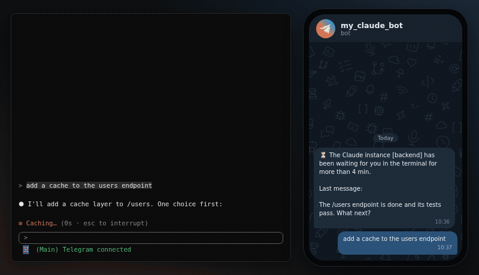
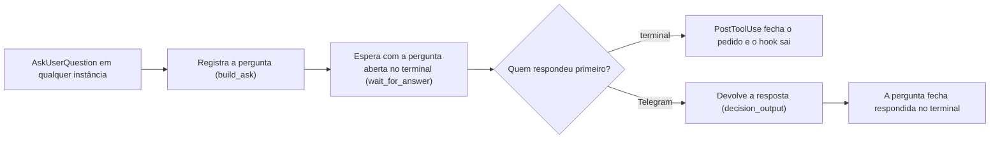

<p align="right"><sub><a href="README.md">English</a></sub></p>

<div align="center">


# better-claude-code-telegram

[](https://github.com/pedromondek/better-claude-code-telegram/actions/workflows/ci.yml)
[](https://www.npmjs.com/package/@pedromondek/better-claude-code-telegram)
[](LICENSE)
[](https://docs.anthropic.com/en/docs/claude-code)
[](#-requisitos)
[](#-requisitos)
[](docs/windows/windows.pt-br.md)

</div>

Telegram para o Claude Code, feito sobre o [plugin oficial do canal do Telegram](https://github.com/anthropics/claude-plugins-official/tree/main/external_plugins/telegram). Cada usuário liga o Claude Code a um bot próprio. Quando o Claude espera você no terminal por mais tempo que o escolhido, a última mensagem dele, a pergunta do `AskUserQuestion` e o pedido de permissão vão para o Telegram, e você responde por lá. A resposta do `AskUserQuestion` dada no Telegram chega ao terminal como se você a tivesse escolhido ali.

Ele aumenta a sua produtividade. As perguntas são respondidas mais cedo, então as sessões param menos; o seu tempo vai para as decisões, e não para vigiar o terminal; o planejamento melhora, em especial com as ilustrações ligadas; e várias sessões ao mesmo tempo ficam fáceis de acompanhar. No uso do dia a dia, o Claude também passou a fazer bem mais perguntas, o que reduz a chance de uma decisão errada que ele tomaria sozinho.

<p align="center"></p>

O que ele acrescenta ao plugin oficial:

- `AskUserQuestion` espelhado com botões (escolha única, múltipla e a resposta "outra" digitada), respondido pelo Telegram ou pelo terminal, o que vier primeiro.
- Um aviso com a última mensagem do Claude quando ele espera você, um aviso quando um turno para num erro (limite de uso, autenticação, cobrança), e os pedidos de permissão segurados enquanto você está ativo no terminal.
- Todas as instâncias do Claude Code da máquina chegam ao Telegram pelo mesmo bot, identificadas pelo nome da instância.
- O Claude ilustra no Telegram, quando você liga: prints e vídeos do app real, e diagramas mandados como imagem. Gasta mais tokens.
- Nada é cortado: a mensagem longa segue em mensagens seguidas, e tabela, negrito e código saem formatados para o Telegram, a tabela como colunas alinhadas.
- Horário de silêncio, transcrição local de áudio com `faster-whisper` e um indicador opcional na statusline.
- Mensagens ao usuário em inglês e em português do Brasil, escolhido no setup.

Todas as funcionalidades, com as demonstrações, estão em [Funcionalidades](docs/features/features.pt-br.md).

O `claude` comum continua como antes. Só a instância aberta com `claude --telegram` fala com o bot, e as outras instâncias da máquina chegam ao Telegram por ela enquanto ela está aberta.

## ❓ Perguntas frequentes

<details>
<summary>Ver as perguntas</summary>

<details>
<summary><b>Por que não simplesmente usar o Remote Control?</b></summary>

1. **As ferramentas de mensageria do próprio Telegram:** botões, respostas citadas, áudio, arquivos e notificações que funcionam como em qualquer conversa.
2. **Só você:** o Remote Control e as notificações do app servem a todos que entram na conta, então numa conta compartilhada todos veem e respondem. Aqui o bot fala só com a sua conta do Telegram pareada.

</details>

<details>
<summary><b>Por que não simplesmente usar o canal oficial do Telegram?</b></summary>

Alguns eventos do Claude Code não são bem integrados lá. Um `AskUserQuestion` trava a sessão inteira até alguém responder no terminal, e nunca chega ao Telegram. Esse é o principal problema que levou a criar este projeto.

</details>

<details>
<summary><b>As minhas mensagens passam por algum servidor seu?</b></summary>

Não. Este projeto não tem servidor: tudo roda na sua máquina, e as mensagens vão só entre ela e o Telegram, pelo seu próprio bot.

</details>

<details>
<summary><b>Funciona com o computador desligado?</b></summary>

Não. O bot vive dentro da sessão do `claude --telegram` na sua máquina: com a máquina em repouso ou a sessão fechada, nada chega ao Telegram.

</details>

<details>
<summary><b>Gasta mais tokens?</b></summary>

A tendência é ter algum aumento. As perguntas, os botões e os avisos passam pelos hooks e pelo binário `bcct`, sem um turno do Claude; as suas respostas e as respostas do Claude no Telegram são mensagens normais; prints e vídeos são o que mais gasta, e ficam desligados a menos que você os ligue. Em troca, vem o ganho de produtividade descrito no topo.

</details>

<details>
<summary><b>Vai atender os outros canais também (ex.: Discord)?</b></summary>

Não está nos planos. O Telegram tem uma gama enorme do que um bot pode fazer, é fácil de acessar e de usar, e dá a você o controle da segurança da sua conta (verificação em duas etapas, sessões ativas) e um bot restrito a você.

</details>

<details>
<summary><b>Pretende dar suporte a outros agentes de código (ex.: Codex)?</b></summary>

Não está nos planos. O Claude Code é a minha ferramenta do dia a dia, por isso o meu foco está nele. Se eu vier a usar outros agentes de código, pode ser que aconteça.

</details>

</details>

## 🔒 Seguro de fábrica

- O token do bot é pedido sem aparecer na tela e gravado legível só por você, e uma regra de negação impede o Claude Code de ler esse arquivo diretamente (ela não cobre um `grep -r` ou um script).
- Só a sua conta pareada do Telegram fala com o bot.
- O binário `bcct` é conferido pelo `checksums.txt` que o release grava antes de ser instalado.
- Cada binário do release é atestado pelo workflow que o construiu (`gh attestation verify`) e publicado num Release imutável do GitHub, conferido de novo depois de publicado.
- Os pacotes do npm saem deste repositório por trusted publishing, com a proveniência do npm, menos a primeira versão de cada pacote, posta em stage pelo login do mantenedor, porque o npm só confia num publisher para um pacote que já existe.

## 🛡 Use com cuidado

1. **Use um bot só para o Claude**, com um nome discreto: quem tem o token controla o bot.
2. **Restrinja o bot a você.** No @BotFather, Restrict bot usage → ligado → só a sua conta. Pareie só você e desligue os grupos (`/setjoingroups` → `Disable`).
3. **Proteja a sua conta do Telegram:** quem entrar nela fala com o Claude como você. Ligue a verificação em duas etapas e a senha de bloqueio, e encerre as sessões que você não reconhece (Configurações › Dispositivos).
4. **Feche o `claude --telegram` quando não estiver usando,** para o bot não ficar escutando à toa.
5. **Leia o pedido de permissão antes de aprovar pelo celular:** um toque no ✅ executa o comando. Mantenha os pedidos de permissão ligados; o `claude --telegram` se recusa a abrir sem eles.
6. **Root, admin ou sudo** dão ao Claude, e a quem estiver na sua conta do Telegram, a máquina inteira. Use um usuário comum quando der.
7. **Nunca mande token, senha ou chave pelo Telegram,** e deixe as ilustrações desligadas numa tela com dado sensível: o chat do bot não tem criptografia de ponta a ponta.
8. **Botão de pânico:** o `/revoke` no @BotFather invalida o token na hora; depois o `bcct setup token` grava o novo.

Todas as recomendações estão em [Setup › Segurança](docs/setup/setup.pt-br.md#-segurança).

## ✨ Uso recomendado

<details>
<summary>Cinco hábitos para aproveitar melhor</summary>

1. **Deixe o `claude --telegram` numa sessão só dele, separada das sessões de trabalho.** Ela vira a secretária: orquestra, repassa o que as outras sessões mandam e entrega cada pedido à sessão dona dele, assim as suas mensagens não interrompem o trabalho nem enchem o contexto dele. Se você já usa várias sessões de trabalho ao mesmo tempo, isso é altamente recomendado. Se você tem uma sessão orquestradora, abra essa com `claude --telegram`. Veja [Uma sessão para o Telegram](docs/secretary/secretary.pt-br.md).
2. **Deixe o autocompact ligado em todas as sessões:** elas rodam por muito tempo, e um contexto cheio impede a sessão de responder você.
3. **Use um tempo de espera por tipo:** curto para perguntas e pedidos de permissão, mais longo para o aviso de espera (`bcct setup delay`).
4. **Responda ("reply") a uma mensagem do bot** para dar contexto ao Claude: o texto citado vai junto.
5. **Ligue as ilustrações só quando precisar** (`/bcct:visuals`): prints e vídeos gastam mais tokens.

</details>

## 📋 Requisitos

- Linux ou macOS, em x64 ou arm64. O Windows nativo tem suporte básico: veja [Windows nativo](docs/windows/windows.pt-br.md).
- [Claude Code](https://docs.anthropic.com/en/docs/claude-code), [Bun](https://bun.sh) e git no `PATH`. No Linux e no macOS, o setup oferece instalar o Claude Code ou o Bun que faltar, pelo instalador oficial.
- Node.js 24.11 ou mais novo, só para o `npx` que instala. O `bcct` instalado e o canal não usam o Node.
- Opcional, para a transcrição de áudio: Python 3 com `venv`, ou o [uv](https://docs.astral.sh/uv/).
- Opcional, para diagramas enviados como imagem: [`@mermaid-js/mermaid-cli`](https://github.com/mermaid-js/mermaid-cli) (`mmdc`).

## 📦 Instalação

1. No Telegram, abra o [@BotFather](https://t.me/BotFather), mande `/newbot` e guarde o token. Use um bot só para o Claude.
2. Rode:

   ```sh
   npx @pedromondek/better-claude-code-telegram
   ```

   O npm traz o binário `bcct` da sua plataforma, conferido pelo `checksums.txt`; se o npm o deixou de fora, ele oferece baixar o binário do Release do GitHub, e o `--download-binary` baixa sem perguntar. Depois o setup pergunta o idioma, o token do bot e o pareamento da sua conta, o tempo de espera, o lembrete e o horário de silêncio, a transcrição de áudio e os extras, e confere tudo com o `bcct health`.

3. Abra um terminal novo, para o shell carregar a função do `claude --telegram`.

Cada etapa, os comandos e onde fica cada coisa estão em [Setup](docs/setup/setup.pt-br.md). Para mudar uma configuração depois, rode a etapa dela (`bcct setup delay`), ou use os comandos `/bcct:` dentro do Claude Code (`/bcct:delay`).

## 🚀 Uso

- **Deixe uma sessão só para o Telegram**, a secretária, ou abra a sua sessão orquestradora com `claude --telegram`: veja [Uma sessão para o Telegram](docs/secretary/secretary.pt-br.md).
- **`claude --telegram`** abre a instância do Telegram. Os outros argumentos passam para o `claude` (`claude --telegram --continue`). O `bcct launch` faz o mesmo sem a função do shell, com os mesmos argumentos.
- **Sem o setup feito, ele não abre.** Faltando o token ou o pareamento, ele para e diz qual etapa falta.
- **Uma instância do Telegram por máquina.** Uma segunda é recusada enquanto o bot da primeira estiver de pé.
- **Dentro dela, `/resume` troca de conversa** sem desligar o Telegram: o bot fica preso à instância, não à conversa.
- **`bcct release [sessão]`** (ou `/bcct:release`) manda na hora ao Telegram as perguntas, os avisos de erro e os avisos de espera que ainda esperam o tempo ou estão guardados pelo silêncio; com o começo do id de uma sessão, só os dela.
- **A statusline** (quando ligada) mostra 📱 (Principal) Telegram conectado na instância do Telegram e 📱 (Secundário) Telegram conectado nas outras enquanto o bot está de pé, Telegram conectando… logo depois que o `claude --telegram` abre, e Telegram fora em vermelho quando ele cai.
- **`bcct health`** confere a instalação, o bot, o pareamento, a proteção do token e os extras, e o `bcct health --fix` oferece consertar o que ele consegue.
- **`bcct update [stable | beta | alpha | <versão>]`** atualiza os plugins e o binário, mostrando o que mudaria e perguntando antes de aplicar. Os estágios estão em [Versionamento](docs/versioning/versioning.pt-br.md).
- **`bcct uninstall`** (ou `npx @pedromondek/better-claude-code-telegram uninstall`) tira só o que o setup pôs; o `bcct uninstall <versão>` tira uma versão instalada do binário.

## 📨 O que vai ao Telegram

Tudo, menos o aviso de erro, espera o tempo do seu tipo sem resposta no terminal, e tudo fica guardado durante o horário de silêncio. O bot avisa quando o silêncio começa, com o horário do fim, e no fim resume o que ficou guardado antes de mandar.

| Situação                                     | No Telegram                                                                                                                                         | A sua resposta                                                                                                  |
| -------------------------------------------- | --------------------------------------------------------------------------------------------------------------------------------------------------- | --------------------------------------------------------------------------------------------------------------- |
| O Claude termina o turno esperando você      | A última mensagem dele, inteira                                                                                                                     | Chega ao Claude como mensagem sua                                                                               |
| `AskUserQuestion` aberto                     | Primeiro o texto que o Claude escreveu antes da pergunta (o contexto), depois cada pergunta inteira, com descrição e prévia das opções, e os botões | Entra no terminal como resposta da pergunta; responder no terminal troca os botões por "Respondida no terminal" |
| Pedido de permissão da instância do Telegram | 🔐 com ✅ Allow e ❌ Deny                                                                                                                           | Aprova ou nega no terminal                                                                                      |
| Um turno para num erro da API                | ⚠️ com a instância e o motivo; no limite de uso, se o Claude continua sozinho e quando                                                              | Chega ao Claude como mensagem sua                                                                               |
| Aviso ou pergunta de outra instância         | O mesmo, com o nome da instância entre colchetes                                                                                                    | A pergunta volta sozinha; a resposta a um aviso a instância do Telegram repassa por `SendMessage`               |

O resto do que chega ao Telegram, como as ilustrações, os áudios e o lembrete de uma escolha pela metade, está em [Funcionalidades](docs/features/features.pt-br.md).

## ⚙ Como funciona

A pergunta do `AskUserQuestion` fica aberta no terminal o tempo todo. O hook `PermissionRequest` registra o pedido e espera; quem responder primeiro, terminal ou Telegram, fecha a pergunta.



O lado do canal, os hooks, a abertura e o detalhe de cada mensagem estão em [Como funciona](docs/how-it-works/how-it-works.pt-br.md).

## 🩺 Problemas comuns

<details>
<summary>Problemas comuns e como resolver</summary>

| Sintoma                                                 | Causa e solução                                                                                           |
| ------------------------------------------------------- | --------------------------------------------------------------------------------------------------------- |
| `error: unknown option '--telegram'`                    | Terminal aberto antes do setup: abra outro ou rode `bcct launch`                                          |
| "O 'claude --telegram' ainda não está configurado"      | Falta o token ou o pareamento: rode `bcct setup token` ou `bcct setup pairing`                            |
| "Já existe uma instância do 'claude --telegram' aberta" | Feche a outra; o bot aceita uma conexão por vez                                                           |
| 📱 Telegram fora                                        | O bot parou de receber (rede, outro processo com o mesmo token): veja o `better-cc-telegram.log` e reabra |
| Nada chega ao Telegram                                  | Rode o `bcct health` e confira o tempo de espera e o silêncio no `better-cc-telegram.json` e o log        |

</details>

## 📣 Acompanhe as novidades no Telegram

Cada versão nova chega ao Telegram com um vídeo curto de cada novidade. Entre no canal que combina com você:

| Canal                                                              | O que publica                                |
| ------------------------------------------------------------------ | -------------------------------------------- |
| [@bcct_tips_br](https://t.me/bcct_tips_br)                         | Versões estáveis, em português               |
| [@bcct_tips_prelancamentos](https://t.me/bcct_tips_prelancamentos) | Todas as versões, inclusive alpha, beta e rc |
| [@bcct_tips](https://t.me/bcct_tips)                               | Versões estáveis, em inglês                  |
| [@bcct_tips_prereleases](https://t.me/bcct_tips_prereleases)       | Todas as versões, em inglês                  |

## 📄 Licença

[Apache-2.0](LICENSE). O plugin do canal vem do plugin oficial do Telegram para o Claude Code, também Apache-2.0; veja o [NOTICE](NOTICE).
