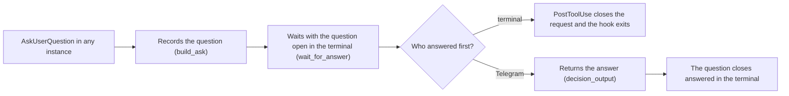
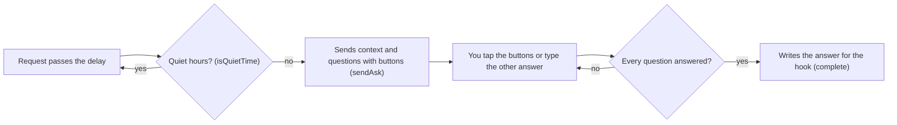

# How it works

[Português](how-it-works.pt-br.md)

How each part of better-claude-code-telegram works: the question that both sides answer, the channel, the hooks, the launcher and the details of what goes to Telegram. To install and configure, see [Setup](../setup/setup.md).

## 💬 The question answered on both sides

The `AskUserQuestion` question stays open in the terminal all the time. The `PermissionRequest` hook records the request and waits; whoever answers first, terminal or Telegram, closes the question.

On the channel side, the request only goes to Telegram after the delay and outside quiet hours, and the answer is only written once every question is answered.

## 🧩 The parts

- **Channel plugin** (`plugins/telegram/`): a copy of the official plugin, with a small patch in `server.ts` that calls `plugins/telegram/extensions/`. [NOTICE](../../NOTICE) lists the upstream version and every change to the upstream files, and `npm run upstream:watch` opens an issue when the official plugin moves past the copied version.
- **Launch** (`bcct launch`): runs `claude` with `BETTER_CC_TELEGRAM=1`, the name `telegram`, the plugin enabled only there (`--settings`) and `--dangerously-load-development-channels`, which the channel of a plugin outside the official list requires.
- **Hooks plugin** (`plugins/telegram-hooks/`), each hook a `bcct hook` command: `PermissionRequest` of `AskUserQuestion` (records and waits for the answer, up to one day), `PostToolUse` of `AskUserQuestion` and `UserPromptSubmit` (close the request), `Stop` (schedules the waiting notice), `StopFailure` (the error notice), `SessionStart` (says when the plugins and the binary have different versions, so `bcct update` is due) and an activity mark of the Telegram instance, used to drop a permission request already resolved in the terminal. Outside the Telegram instance and with no bot up, all of them but `SessionStart` exit before starting `bcct`.
- **Extensions:** every 2 s they check `asks/` and `pings/`, send what is due, handle the buttons and write the answer the hook returns.
- **Channel instructions:** the conversation rules Claude follows in the Telegram instance are in `plugins/telegram/extensions/instructions.ts`. Claude Code reads only the first 4,096 characters of a channel's instructions, so the details of decision questions, tables, images, videos, proposal boards and drawings live in the `telegram:channel-guide` skill (`plugins/telegram/skills/channel-guide/`), which Claude loads before one of them.
- **Illustrations:** the boards and videos come from `plugins/telegram/extensions/page-capture.ts`, which drives the Chromium of Playwright and, for video, ffmpeg; diagrams are rendered to PNG by the `mermaid-png.ts` extension and sent through the bot.

## 📨 Details of what goes to Telegram

- When the conversation is already on Telegram (your last message came from there), the Telegram instance's notice is not repeated, and the permission request and the `AskUserQuestion` questions of every instance go right away (still held during quiet hours).
- Claude writes to you on Telegram in the language chosen in the setup.
- Replying to a bot message sends the quoted text to Claude too.
- Tables, bold, code and previews are formatted: a table becomes aligned columns in a monospace block. Nothing is cut; what exceeds Telegram's limit goes in follow-up messages.
- With transcription on (setup step 8, `/bcct:transcription`), voice messages are transcribed on your machine and reach Claude as text. The audio is deleted right after the transcription; the text goes only to Claude and to the log. When transcription fails, the bot says so and the audio goes as an attachment. With transcription off, voice messages go as attachments, and an audio file always goes as an attachment.

Where each file lives is in [Setup](../setup/setup.md#-where-everything-lives).
