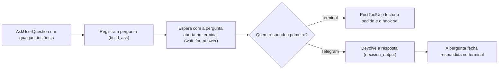
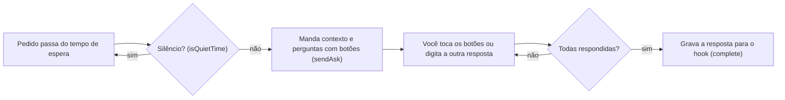

# Como funciona

[English](how-it-works.md)

Como cada parte do better-claude-code-telegram funciona: a pergunta que os dois lados respondem, o canal, os hooks, a abertura e o detalhe do que vai ao Telegram. Para instalar e configurar, veja o [Setup](../setup/setup.pt-br.md).

## 💬 A pergunta respondida dos dois lados

A pergunta do `AskUserQuestion` fica aberta no terminal o tempo todo. O hook `PermissionRequest` registra o pedido e espera; quem responder primeiro, terminal ou Telegram, fecha a pergunta.

Do lado do canal, o pedido só vai ao Telegram depois do tempo de espera e fora do silêncio, e a resposta só é gravada quando todas as perguntas foram respondidas.

## 🧩 As partes

- **Plugin do canal** (`plugins/telegram/`): cópia do plugin oficial, com um patch pequeno no `server.ts` que chama `plugins/telegram/extensions/`. O [NOTICE](../../NOTICE) lista a versão do upstream e cada mudança nos arquivos dele, e o `npm run upstream:watch` abre uma issue quando o plugin oficial sai da versão copiada.
- **Abertura** (`bcct launch`): roda o `claude` com `BETTER_CC_TELEGRAM=1`, o nome `telegram`, o plugin ativado só ali (`--settings`) e `--dangerously-load-development-channels`, que o canal de um plugin fora da lista oficial exige.
- **Plugin de hooks** (`plugins/telegram-hooks/`), cada hook um comando `bcct hook`: `PermissionRequest` do `AskUserQuestion` (registra e espera a resposta, até um dia), `PostToolUse` do `AskUserQuestion` e `UserPromptSubmit` (fecham o pedido), `Stop` (agenda o aviso de espera), `StopFailure` (o aviso de erro), `SessionStart` (avisa quando os plugins e o binário estão em versões diferentes, e é hora do `bcct update`) e uma marca de atividade da instância do Telegram, usada para descartar o pedido de permissão já resolvido no terminal. Fora da instância do Telegram e sem bot de pé, todos menos o `SessionStart` saem antes de subir o `bcct`.
- **Extensões:** a cada 2 s olham `asks/` e `pings/`, mandam o que venceu, tratam os botões e gravam a resposta que o hook devolve.
- **Instruções do canal:** as regras de conversa que o Claude segue na instância do Telegram ficam em `plugins/telegram/extensions/instructions.ts`. O Claude Code lê só os primeiros 4.096 caracteres das instruções de um canal, então o detalhe de pergunta de decisão, tabela, imagem, vídeo, quadro de propostas e desenho fica na skill `telegram:channel-guide` (`plugins/telegram/skills/channel-guide/`), que o Claude carrega antes de um deles.
- **Ilustrações:** os quadros e vídeos saem do `plugins/telegram/extensions/page-capture.ts`, que usa o Chromium do Playwright e, para o vídeo, o ffmpeg; os diagramas viram PNG pela extensão `mermaid-png.ts` e vão pelo bot.

## 📨 Detalhes do que vai ao Telegram

- Se a conversa já está no Telegram (a sua última mensagem veio de lá), o aviso da instância do Telegram não é repetido, e o pedido de permissão e as perguntas do `AskUserQuestion` de todas as instâncias vão na hora (ainda guardados no horário de silêncio).
- O Claude escreve para você no Telegram no idioma escolhido no setup.
- Responder ("reply") a uma mensagem do bot leva junto, para o Claude, o texto que você citou.
- Tabela, negrito, código e prévia saem formatados: tabela vira colunas alinhadas em bloco monoespaçado. Nada é cortado; o que passa do limite do Telegram vai em mensagens seguidas.
- Com a transcrição ligada (etapa 8 do setup, `/bcct:transcription`), a mensagem de voz é transcrita na sua máquina e chega ao Claude como texto. O áudio é apagado logo depois da transcrição; o texto vai só para o Claude e para o log. Se a transcrição falhar, o bot avisa e o áudio vai como anexo. Com a transcrição desligada, a mensagem de voz vai como anexo, e um arquivo de áudio vai sempre como anexo.

Onde fica cada arquivo está no [Setup](../setup/setup.pt-br.md#-onde-fica-cada-coisa).
