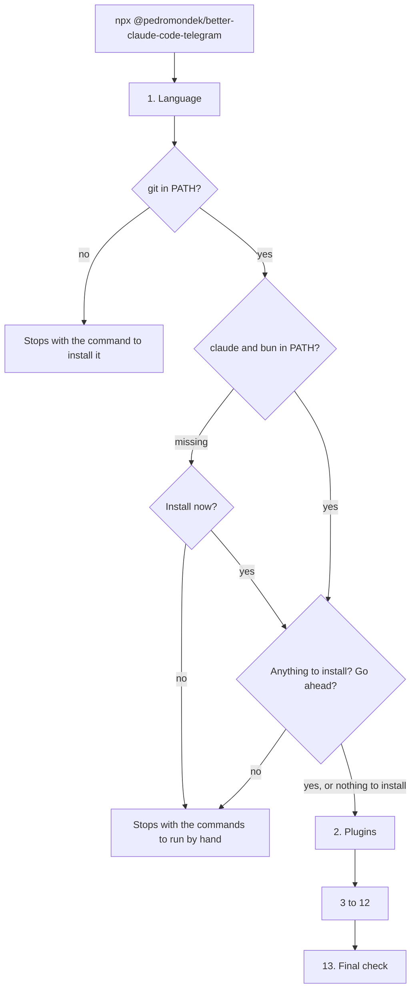

# Setup

[Português](setup.pt-br.md)

`npx @pedromondek/better-claude-code-telegram` installs the `bcct` command and runs the setup, which prepares everything `claude --telegram` needs: the plugins, the bot token, the pairing of your account and your preferences. You can run it again as often as you like.

## 🧭 Overview

The full setup runs these steps, always in this order, and ends with the final check:

| #   | Step                            | What it sets                                                                         |
| --- | ------------------------------- | ------------------------------------------------------------------------------------ |
| 1   | 🌐 Language / Idioma            | The language of the messages in the terminal and on Telegram                         |
| 2   | 🧩 Plugins                      | Marketplace, plugins and the line that loads `claude --telegram`                     |
| 3   | 🔑 Bot token                    | The bot Claude uses                                                                  |
| 4   | 🔗 Pairing                      | The only Telegram account that talks to the bot                                      |
| 5   | ⏳ Wait time                    | Minutes without an answer in the terminal before going to Telegram                   |
| 6   | 🔔 Reminder                     | Minutes a multi-select question waits on Telegram before the reminder to conclude it |
| 7   | 🌙 Quiet hours                  | When nothing goes to Telegram                                                        |
| 8   | 🎤 Audio transcription          | Local transcription of voice messages                                                |
| 9   | 📥 Received files               | How many days the photos and files you send are kept                                 |
| 10  | 🖼 Illustrations on Telegram     | Screenshots and video Claude may send                                                |
| 11  | 📊 Status line                  | The Telegram indicator in Claude Code's footer                                       |
| 12  | 💻 bcct command in the terminal | Whether `bcct` is on your `PATH`                                                     |
| 13  | 🩺 Final check                  | The health checks, at the end                                                        |

- **Enter on an empty answer keeps the default or the existing setting.** The option saved before is marked "(previously chosen)", and the suggested one "(Recommended)".
- **Running it again does not rewrite what did not change.** What was already right shows with ○ ("kept", "already installed").
- **In a terminal, questions are answered with the arrow keys.** Outside a terminal (pipe, script), the setup reads the typed answer and asks again when it is not valid.
- **Every action that waits shows a line with a spinner**, which turns into ✔ (done), ○ (already that way) or ✘ (failed).
- **At the end of the full setup**, it suggests keeping one Claude Code session just for Telegram: see [One session for Telegram](../secretary/secretary.md).



## 📋 Requirements

- **Node.js 24.11 or newer**, only for the `npx` that installs. Once installed, nothing runs on Node: the setup does not check it, and the health checks do not either.
- **git**, which Claude Code needs to download the plugins. Without it, the plugins step stops and shows how to install it.
- **Claude Code and Bun** in `PATH`. When one is missing, the setup offers to install it with its official installer. On native Windows it cannot, so install them first (see [Native Windows](../windows/windows.md)).
- **uv**, only for the transcription, offered when there is neither `uv` nor `python3`.
- **mermaid-cli (`mmdc`)**, optional, for the diagrams Claude sends as images. The setup does not install it.

Declining the installation of `claude` or `bun` is not an error: it shows "Nothing was installed; … is still missing from PATH." and the commands to run by hand. The setup stops there, since it cannot go on without the tool.

The `npx` takes the binary from the npm package of your platform. When npm left that package out, it explains why and, in a terminal, offers to download the binary from the GitHub Release, checked against `checksums.txt`; `--download-binary` downloads it without asking.

## 🪜 The steps

### 1. 🌐 Language / Idioma

`English / Inglês (en-us)` or `Português Brasileiro / Brazilian Portuguese (pt-br)`. The suggestion comes from the system language (`LC_ALL`, `LC_MESSAGES` or `LANG`, in that order), and en-us when it is not recognized. Until a language is saved, the opening lines show in both languages.

### 2. 🧩 Plugins

1. Checks that `git`, `claude` and `bun` are in `PATH` (see [Requirements](#-requirements)).
2. Shows what it found:
   ```
   ✔ Checked:
     ✔ Marketplace registered
     ✔ 2 of 2 required plugins installed
     ○ 0 of 1 optional plugin installed
   ```
3. When something required is missing, shows the plan and asks **"Go ahead with the installation?"**. The plan may include:
   - registering the `better-claude-code-telegram` marketplace from GitHub, on the `stable` branch for a stable version or on the tag of a test version;
   - installing `telegram@better-claude-code-telegram` (the channel) and `telegram-hooks@better-claude-code-telegram` (the hooks) for your user;
   - adding to the shell rc the line that loads `claude --telegram`.
4. Asks about the optional `bcct` plugin (the `/bcct:` commands inside Claude Code). When it is already installed, the question becomes **Keep them** or **Remove them**.
5. Installs what is missing and keeps the channel **disabled outside `claude --telegram`**, so the other instances do not start the bot. The hooks (and `bcct`) stay enabled in all of them.
6. Writes `~/.claude/better-claude-code-telegram/shell.sh`, with the `claude` function that sends `claude --telegram` to `bcct launch`, and adds the line that loads it to the rc of your `$SHELL` (`~/.zshrc` for zsh, `~/.bashrc` for bash, `~/.bash_profile` for bash on macOS when it exists), creating the file when missing. It also adds it to `~/.bashrc` or `~/.zshrc` when that other one exists. The line carries the marker `# Added by better-claude-code-telegram setup`. fish is not supported: the setup warns and shows the line to load in bash or zsh.

Declining the plan shows "Nothing was installed." and the commands to run by hand.

### 3. 🔑 Bot token

- In the full setup, with a saved token, asks **"Use the saved bot, @your_bot?"**.
- A new token is typed without showing in the terminal, checked with Telegram (`getMe`) and saved in `~/.claude/channels/telegram/.env`, readable only by you (0600), like in the official plugin.
- **Security rule:** adds to `~/.claude/settings.json` a `permissions.deny` with `Read(~/.claude/channels/telegram/.env)`, so Claude Code does not read the token file.
- When the bot can be added to groups, it warns how to turn that off: in @BotFather, `/setjoingroups`, your bot and `Disable`.

### 4. 🔗 Pairing

- Already paired: asks **"Keep this account"** (default) or **"Pair another account (with a new code)"**.
- `claude --telegram` must be closed, since it holds the bot. A bot with a webhook set is refused: use a bot only for Claude.
- The setup shows a link (`t.me/your_bot?start=code`) and the code. Tap **Start** in the link or send the code to the bot.
- It waits up to 3 min. Only the message with that code counts; a message from someone else is ignored.
- Confirms the account (**"Pair with @you (id …)?"**), writes `access.json` with it as the only allowed account and greets you in the chat.

### 5. ⏳ Wait time

Minutes without an answer in the terminal before a notice goes to Telegram. Options: **Right away**, 1, 3, **4 (Recommended)**, 5, 10, 15 min, **Per kind…** or Custom.

- **Per kind…** asks one time for each kind: Questions (`AskUserQuestion`), Permission requests and Waiting notice (when Claude stops and waits for you).
- **Custom** asks the minutes; 0 means right away.

To test without waiting, `BETTER_CC_TELEGRAM_DELAY_MS=15000 claude --telegram` sets the delay to 15 s for every kind and for the reminder, in that instance only.

### 6. 🔔 Reminder

The step `reminder` sets the **reminder**: the minutes a multi-select question waits on Telegram before the reminder to conclude it. Options: **Right away**, 1, **3 (Recommended)**, 4, 5, 10, 15 min or Custom. The reminder is saved as `delays.reminder`, never follows the wait time above, and stays at 3 minutes until you set it. Changing the wait time, single or per kind, keeps it.

### 7. 🌙 Quiet hours

When nothing goes to Telegram. What comes due in that window is held for later, and `/bcct:release` sends it right away.

| Option                 | Hours                                  |
| ---------------------- | -------------------------------------- |
| Off (default)          | —                                      |
| Outside business hours | 18:00-08:00                            |
| All night              | 18:00-07:00                            |
| Night                  | 22:00-07:00                            |
| Small hours            | 00:00-07:00                            |
| Custom                 | Start and end in two questions (HH:MM) |

### 8. 🎤 Audio transcription

Turns the voice messages you send on Telegram into text, on your machine, with `faster-whisper`.

| Model            | What it is like                                    | Storage |
| ---------------- | -------------------------------------------------- | ------- |
| `base` (default) | fastest, uses the least RAM, fine for clear speech | ~0.1 GB |
| `small`          | more accurate, slower, uses more RAM               | ~0.5 GB |
| `medium`         | most accurate, much slower, uses much more RAM     | ~1.5 GB |

- The menu splits the models into "Installed:" and "To download:". Switching to an installed model downloads nothing.
- Turning it on creates the Python environment in `~/.claude/better-claude-code-telegram/whisper/venv` (with `uv`, or with Python's `venv`) and downloads the model. The output of pip and of the download only shows when something fails.
- **Off** makes voice messages reach Claude as attachments.
- **Uninstall** (with a model installed) removes the models you pick.
- After switching models, it offers to remove the other installed ones.

### 9. 📥 Received files

Days to keep the photos and files you send on Telegram: 1, 3, **7 (default)**, 14, 30, Never delete or Custom. The channel cleans the `inbox/` folder when it opens and every hour.

### 10. 🖼 Illustrations on Telegram

Whether Claude illustrates what it sends on Telegram with screenshots and video, which cost more tokens: **Off** (default), **Screenshots only (today × proposal, area in red)** or **Screenshots and transition video**.

With either of the last two, it asks **Review before sending**: "Claude checks each image before sending (more tokens)" or "Send directly". It warns when the Chromium of Playwright is missing and, for the video, when `ffmpeg` is missing, with the command to install each one. It applies when `claude --telegram` is reopened.

### 11. 📊 Status line

The Telegram indicator in Claude Code's footer. See [The status line indicator](#-the-status-line-indicator).

- **No status line:** asks whether to show the indicator (default: no).
- **A status line of yours:**

  | Option                                 | What it does                                                                                                      |
  | -------------------------------------- | ----------------------------------------------------------------------------------------------------------------- |
  | 1. Next to yours                       | Yours stays and the indicator shows beside it (yours is saved in `statusline-previous.json`)                      |
  | 2. Instead of yours                    | Only the indicator; it first copies `settings.json` to `settings.json.bak.<n>`, and yours comes back on uninstall |
  | 3. Ask Claude to fit it into mine      | On the next `claude --telegram`, Claude asks how to fit the indicator into yours and changes only yours           |
  | 4. Nowhere (keep only yours) (default) | Nothing changes                                                                                                   |

- **With the indicator already installed:** **Keep it** (default) or **Remove it**. Removing brings back your previous status line, when there was one.

Option 3 does not touch `settings.json`: it notes the request, and `claude --telegram` hands it to Claude as the first message of the session. That only happens when every argument you passed starts with `-`; otherwise the request waits for the next launch. Once it is done, the step shows **"Keep yours (it already has the indicator)"**.

### 12. 💻 bcct command in the terminal

Asks whether to add `bcct` to your `PATH`, so `bcct setup`, `bcct health` and the others work in the terminal without `npx`. Yes adds `~/.claude/better-claude-code-telegram/bin` to the `PATH` in `shell.sh`, for new terminals; no takes it out again. On native Windows, it also changes your user `PATH` (see [Native Windows](../windows/windows.md)).

### 13. 🩺 Final check

Runs the health checks and shows the result group by group:

| Group    | Checks                                                                               |
| -------- | ------------------------------------------------------------------------------------ |
| Install  | claude, bun, Git, Plugins, Launcher, Version, Shell, bcct on PATH, App folder, Hooks |
| Telegram | Bot token, Groups, Pairing, Connection                                               |
| Security | Running as root, Token protection, Settings                                          |
| Extras   | Transcription, Diagrams (mmdc), Chromium (screenshots), ffmpeg (video), Status line  |

The `bcct` plugin is optional and does not fail the health checks.

## ⌨ Commands

Every step runs alone or with others, by its name: `language`, `plugin`, `token`, `pairing`, `delay`, `reminder`, `quiet-hours`, `transcription`, `inbox`, `visuals`, `statusline` and `path`.

| Command                                                      | What it does                                                          |
| ------------------------------------------------------------ | --------------------------------------------------------------------- |
| `npx @pedromondek/better-claude-code-telegram`               | The full setup                                                        |
| `npx @pedromondek/better-claude-code-telegram delay inbox`   | Only those steps                                                      |
| `npx @pedromondek/better-claude-code-telegram uninstall`     | Undoes the setup (see [Uninstall](#-uninstall))                       |
| `bcct setup [<step> …]`                                      | The same as the `npx`, once `bcct` is on your `PATH` (step 12)        |
| `bcct setup --set <setting> <value>`                         | Changes one setting without the questions (see below)                 |
| `bcct setup --show`                                          | Prints the current settings as JSON                                   |
| `bcct health [install\|telegram\|security\|extras] [--json]` | The checks, of every group or of those only; `--json` for scripts     |
| `bcct health --fix [--yes] [--only <ids>]`                   | Offers to fix what it can (see below)                                 |
| `bcct update [stable\|beta\|alpha\|<version>] [--check]`     | Updates the plugins and the binary; `--check` only shows what changes |
| `bcct -v`                                                    | The active version and the versions kept, by channel                  |
| `bcct uninstall <version>`                                   | Deletes one kept version of the binary, when it is not the active one |
| `bcct launch [<arguments>]`                                  | The same as `claude --telegram`, in a terminal without the function   |

Without `bcct` on your `PATH`, the launcher is `~/.claude/better-claude-code-telegram/bin/bcct` (`bcct.cmd` on Windows). The release channels and versions are in [Versioning](../versioning/versioning.md).

**`--set`** takes `language` (`en-us` or `pt-br`), `delay` (minutes, 0 for right away), `delays` (questions/permissions/waiting notice in minutes, such as `0/4/4`, or `off`), `reminder` (minutes a multi-select question waits before the reminder to conclude it, 0 for right away; 3 by default), `quiet-hours` (`HH:MM-HH:MM` or `off`), `transcription` (`base`, `small`, `medium` or `off`), `inbox` (days, or `off`), `visuals` (`off`, `prints` or `video`), `visual-review` (`on` or `off`) and `statusline` (`on`, `after`, `replace`, `custom` or `off`).

**`--fix`** lists what it can fix and what it only recommends. It fixes `shell` (the `shell.sh` and the rc line), `protection` (the deny rule of the token), `app` (the permission of the app folder) and `update` (runs `bcct update`). `--fix --yes` applies them all; `--only shell,protection` picks.

Language, wait time, quiet hours, transcription, received files and status line apply right away. Plugins, token, pairing and illustrations apply when `claude --telegram` is reopened.

**Inside Claude Code**, with the `bcct` plugin: `/bcct:language`, `/bcct:delay`, `/bcct:quiet-hours`, `/bcct:transcription`, `/bcct:inbox`, `/bcct:visuals` and `/bcct:statusline` change the settings through `bcct setup --set`; `/bcct:health` runs the checks and offers the fixes; `/bcct:update` updates; `/bcct:release` sends right away what the wait time or the quiet hours hold. `/bcct:setup`, `/bcct:token`, `/bcct:pairing` and `/bcct:uninstall` only show the command to run in your terminal, since they need the token, a code or the questions.

## 📂 Where everything lives

**Settings and state of this project**, in `~/.claude/better-claude-code-telegram/` (or in `BETTER_CC_TELEGRAM_DIR`):

| File                        | Contents                                                                                                                                                         |
| --------------------------- | ---------------------------------------------------------------------------------------------------------------------------------------------------------------- |
| `better-cc-telegram.json`   | `language`, `delayMinutes`, `delays`, `quietHours`, `transcription`, `inboxRetentionDays`, `visuals`, `visualReview`, `statuslineCustomized` and `commandOnPath` |
| `better-cc-telegram.log`    | What the channel extensions did (reset past 1 MB)                                                                                                                |
| `bin/`                      | The `bcct` launcher, the active version (`current`) and the installed versions (`versions/`)                                                                     |
| `shell.sh`                  | The `claude` function and, with step 12, the `PATH` entry                                                                                                        |
| `health.json`               | Whether the bot is receiving, read by the status line and the health checks                                                                                      |
| `launch.json`               | When `claude --telegram` opened, so the indicator can show "connecting…"                                                                                         |
| `statusline-previous.json`  | Your status line, when the indicator goes next to it or instead of it                                                                                            |
| `statusline-customize.json` | The request for Claude to fit the indicator into your status line, until it is handed over                                                                       |
| `asks/`, `pings/`           | Pending questions and notices                                                                                                                                    |
| `whisper/venv/`             | The Python environment of the transcription                                                                                                                      |

**Files of the official channel plugin**, in `~/.claude/channels/telegram/` (or in `TELEGRAM_STATE_DIR`): `.env` (the token), `access.json` (the paired account), `inbox/` (what you send) and `bot.pid`.

**Outside both folders:**

- `~/.claude/settings.json`: `statusLine`, the `permissions.deny` rule for `.env` and `enabledPlugins` for the plugins.
- `~/.claude/settings.json.bak.<n>`: the copy made before replacing the status line with ours.
- `~/.zshrc`, `~/.bashrc` or `~/.bash_profile`: the line with the marker.
- The Hugging Face cache (`~/.cache/huggingface/hub`, or `HF_HUB_CACHE`, `HF_HOME` or `XDG_CACHE_HOME` when set): the transcription models, in `models--Systran--faster-whisper-<model>`.

When `CLAUDE_CONFIG_DIR` is set, it takes the place of `~/.claude` in every path.

## 📊 The status line indicator

| Situation                                             | In the `claude --telegram` session (Main)            | In the other sessions (Secondary)                                |
| ----------------------------------------------------- | ---------------------------------------------------- | ---------------------------------------------------------------- |
| Bot receiving messages                                | 🟢 📱 (Main) Telegram connected                      | 🟢 📱 (Secondary) Telegram connected                             |
| Up to 60 s after opening, not receiving yet           | 🟡 📱 (Main) Telegram connecting…                    | 🟡 📱 (Secondary) Telegram connecting…, once the channel reports |
| The channel runs, but the bot stopped receiving       | 🔴 📱 (Main) Telegram down                           | 🔴 📱 (Secondary) Telegram down                                  |
| The channel server stopped reporting in this instance | 🔴 📱 (Main) Telegram down · type /mcp reconnect all | nothing                                                          |
| No `claude --telegram` open                           | —                                                    | nothing                                                          |

The **Connection** check of the health follows the same rule: in the 60 s after opening, it shows ○ "connecting", without failing.

## ↩ Ctrl+C and undo

- **Ctrl+C on a question** asks "Leave the setup?" (**Go on where it stopped** or **Leave**).
- **When you leave, or when a step fails,** the setup lists what it did so far, with each changed option as before → after:
  ```
  So far the setup has:
    • created ~/.claude/better-claude-code-telegram/better-cc-telegram.json
      – 🌐 Language / Idioma: not set → en-us
  ```
- Then it asks **Undo everything** or **Keep it as it is**. After Ctrl+C the default is to undo; after an error, to keep.
- **Undo** brings files back to their original content, deletes the folders it created, undoes the marketplace and the plugins installed or removed in that run and, on native Windows, the change to your user `PATH`.
- **Left as they are:** `claude`, `bun` and `uv` installed by the setup, which you remove by hand if you want.

## 🗑 Uninstall

`npx @pedromondek/better-claude-code-telegram uninstall` (or `bcct uninstall`) requires `claude --telegram` to be closed. It:

1. Removes the line with the marker from the shell rcs and deletes `shell.sh`.
2. Removes the indicator from `settings.json` and brings back your previous status line, when there was one. It also removes the `.env` rule.
3. On native Windows, takes the `bin` folder out of your user `PATH`.
4. Removes the plugins and the marketplace. What was not installed shows as ○ "was not installed".
5. Warns when your status line still calls the indicator Claude added to it, with the call to remove.
6. Asks before deleting the local transcription (the Python environment and the downloaded models), mermaid-cli and, last, the token and the pairing in `~/.claude/channels/telegram/` with the whole `~/.claude/better-claude-code-telegram/` folder, the `bcct` binaries included. All three answers default to **no**. The first two are asked only when the transcription files or `mmdc` exist.

`claude`, `bun` and `uv` stay installed. At the end, it asks you to open a new terminal, so it loads the shell without `bcct`.

## 🔒 Security

- **Use a bot only for Claude**, with a discreet username. The bot has no owner in the Telegram API: whoever has the token controls the bot.
- **One account only.** Pairing saves only your account, and the health checks fail when `access.json` lets other accounts, groups or pending pairings in (`dmPolicy` other than `allowlist`). In @BotFather, also turn on Restrict bot usage for your account only.
- **Protect your Telegram account:** whoever gets into it talks to Claude as you. Turn on two-step verification and a passcode, and end the sessions you do not recognize (Settings › Devices).
- **Close `claude --telegram` when you are not using it**, so the bot is not left listening for nothing.
- **The token stays out of Claude's reach**, through the `permissions.deny` rule. The rule covers direct reads and `cat`/`head`/`tail`/`sed`, not a `grep -r` or a script.
- **`claude --telegram` does not start without the permission checks** (`--dangerously-skip-permissions`, `--allow-dangerously-skip-permissions`, `--permission-mode bypassPermissions` or `defaultMode: bypassPermissions` in the settings). With the channel on, a message on Telegram could make Claude run anything without asking.
- **Prompt injection:** what arrives through Telegram becomes instructions for Claude. Keep the permission requests on, read each one before you approve it on the phone (one tap on ✅ runs the command) and do not forward messages from other people to the bot.
- **Never send a token, password, key or `.env` through Telegram.** Bot chats are not end-to-end encrypted, and Claude is instructed not to send secrets there. For the same reason, keep the illustrations off on a screen with sensitive data: the screenshots and videos show whatever is on it.
- **Root, admin or sudo** give Claude, and anyone in your Telegram account, the whole machine. Use a regular user when you can; the health checks warn when it runs as root.
- **Groups:** turn them off in @BotFather (`/setjoingroups` → `Disable`). The setup and the health checks warn when the bot accepts groups.
- **Received files** are deleted after the period chosen in step 9.
- **Recommended, outside the setup:** add `deny` rules for `~/.ssh`, `~/.aws` and other credentials to your `~/.claude/settings.json`. The setup does not do it for you, since it is your own policy, beyond this project.
- **Panic button:** in @BotFather, `/revoke` invalidates the token at once. Then `npx @pedromondek/better-claude-code-telegram token` saves the new one. The same works for rotating the token from time to time.

## 🩺 Common problems

| Symptom                                                 | What to do                                                                                                                 |
| ------------------------------------------------------- | -------------------------------------------------------------------------------------------------------------------------- |
| `error: unknown option '--telegram'`                    | The terminal was opened before the setup: open another one, or run `~/.claude/better-claude-code-telegram/bin/bcct launch` |
| "'claude --telegram' is not set up yet"                 | The token or the pairing is missing: run the command it shows                                                              |
| "A 'claude --telegram' instance is already open"        | Close the other one; the bot takes only one connection at a time                                                           |
| "Close the 'claude --telegram' instance before pairing" | Pairing needs the bot free: close it and run `npx @pedromondek/better-claude-code-telegram pairing` again                  |
| "No message with the code arrived in 3 min"             | Run `npx @pedromondek/better-claude-code-telegram pairing` and send the new code to the right bot                          |
| 📱 Telegram down after 60 s                             | The bot did not connect (network, another process with the same token): check `better-cc-telegram.log` and reopen          |
| 📱 Telegram down · type /mcp reconnect all              | The channel server stopped in that session: type `/mcp reconnect all` in it                                                |
| Nothing reaches Telegram                                | Check the wait time and the quiet hours (`npx @pedromondek/better-claude-code-telegram delay quiet-hours`) and the log     |
| `bcct health` with ✘                                    | Each line says the command that fixes it; `bcct health --fix` applies what it can                                          |
