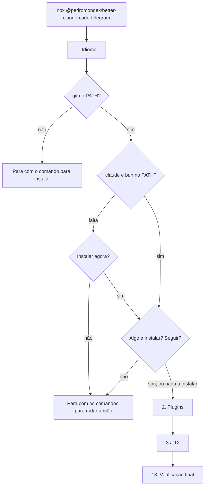

# Setup

[English](setup.md)

O `npx @pedromondek/better-claude-code-telegram` instala o comando `bcct` e roda o setup, que prepara tudo o que o `claude --telegram` precisa: os plugins, o token do bot, o pareamento da sua conta e as suas preferências. Dá para rodar de novo quantas vezes quiser.

## 🧭 Visão geral

O setup completo roda estas etapas, sempre nesta ordem, e termina com a verificação final:

| #   | Etapa                       | O que define                                                                                      |
| --- | --------------------------- | ------------------------------------------------------------------------------------------------- |
| 1   | 🌐 Language / Idioma        | O idioma das mensagens no terminal e no Telegram                                                  |
| 2   | 🧩 Plugins                  | Marketplace, plugins e a linha que carrega o `claude --telegram`                                  |
| 3   | 🔑 Token do bot             | O bot que o Claude usa                                                                            |
| 4   | 🔗 Pareamento               | A única conta do Telegram que fala com o bot                                                      |
| 5   | ⏳ Tempo de espera          | Minutos sem resposta no terminal antes de levar ao Telegram                                       |
| 6   | 🔔 Lembrete                 | Minutos que uma pergunta de múltipla escolha espera no Telegram antes do lembrete para concluí-la |
| 7   | 🌙 Silêncio                 | Quando nada vai ao Telegram                                                                       |
| 8   | 🎤 Transcrição de áudio     | A transcrição local das mensagens de voz                                                          |
| 9   | 📥 Arquivos recebidos       | Quantos dias as fotos e os arquivos que você manda ficam guardados                                |
| 10  | 🖼 Ilustrações no Telegram   | Os prints e o vídeo que o Claude pode mandar                                                      |
| 11  | 📊 Statusline               | O indicador do Telegram no rodapé do Claude Code                                                  |
| 12  | 💻 Comando bcct no terminal | Se o `bcct` fica no seu `PATH`                                                                    |
| 13  | 🩺 Verificação final        | As checagens do health, no fim                                                                    |

- **Enter numa resposta vazia confirma o padrão ou mantém a configuração existente.** A opção salva antes vem marcada "(escolhido anteriormente)", e a sugerida, "(Recomendado)".
- **Rodar de novo não regrava o que não mudou.** O que já estava certo sai com ○ ("mantido", "já instalado").
- **Num terminal, as perguntas se respondem com as setas.** Fora de um terminal (pipe, script), o setup lê a resposta digitada e pergunta de novo quando ela não vale.
- **Toda ação que espera mostra uma linha com spinner**, que vira ✔ (feito), ○ (já estava assim) ou ✘ (falhou).
- **No fim do setup completo**, ele sugere deixar uma sessão do Claude Code só para o Telegram: veja [Uma sessão para o Telegram](../secretary/secretary.pt-br.md).



## 📋 Requisitos

- **Node.js 24.11 ou mais novo**, só para o `npx` que instala. Depois de instalado, nada roda no Node: o setup não o confere, e o health também não.
- **git**, que o Claude Code usa para baixar os plugins. Sem ele, a etapa dos plugins para e mostra como instalar.
- **Claude Code e Bun** no `PATH`. Quando falta um, o setup oferece instalar pelo instalador oficial. No Windows nativo ele não consegue, então instale os dois antes (veja [Windows nativo](../windows/windows.pt-br.md)).
- **uv**, só para a transcrição, oferecido quando não há nem `uv` nem `python3`.
- **mermaid-cli (`mmdc`)**, opcional, para os fluxos que o Claude manda como imagem. O setup não o instala.

Recusar a instalação do `claude` ou do `bun` não é erro: sai "Nada foi instalado; … continua faltando no PATH." e os comandos para rodar à mão. O setup para ali, porque não segue sem a ferramenta.

O `npx` pega o binário do pacote do npm da sua plataforma. Quando o npm deixou esse pacote de fora, ele explica por quê e, num terminal, oferece baixar o binário do Release do GitHub, conferido pelo `checksums.txt`; o `--download-binary` baixa sem perguntar.

## 🪜 As etapas

### 1. 🌐 Language / Idioma

`English / Inglês (en-us)` ou `Português Brasileiro / Brazilian Portuguese (pt-br)`. A sugestão vem do idioma do sistema (`LC_ALL`, `LC_MESSAGES` ou `LANG`, nessa ordem), e é en-us quando ele não é reconhecido. Até um idioma ser salvo, as linhas de abertura saem nos dois idiomas.

### 2. 🧩 Plugins

1. Confere se o `git`, o `claude` e o `bun` estão no `PATH` (veja [Requisitos](#-requisitos)).
2. Mostra o que encontrou:
   ```
   ✔ Conferido:
     ✔ Marketplace registrado
     ✔ 2 de 2 plugins obrigatórios instalados
     ○ 0 de 1 plugin opcional instalado
   ```
3. Quando falta algo obrigatório, mostra o plano e pergunta **"Seguir com a instalação?"**. O plano pode ter:
   - registrar o marketplace `better-claude-code-telegram` do GitHub, na branch `stable` numa versão estável ou na tag de uma versão de teste;
   - instalar o `telegram@better-claude-code-telegram` (o canal) e o `telegram-hooks@better-claude-code-telegram` (os hooks) para o seu usuário;
   - acrescentar no rc do shell a linha que carrega o `claude --telegram`.
4. Pergunta do plugin opcional `bcct` (os comandos `/bcct:` dentro do Claude Code). Quando ele já está instalado, a pergunta vira **Manter** ou **Remover**.
5. Instala o que falta e deixa o canal **desligado fora do `claude --telegram`**, para as outras instâncias não subirem o bot. Os hooks (e o `bcct`) ficam ligados em todas.
6. Grava o `~/.claude/better-claude-code-telegram/shell.sh`, com a função `claude` que manda o `claude --telegram` para o `bcct launch`, e acrescenta a linha que o carrega no rc do seu `$SHELL` (`~/.zshrc` no zsh, `~/.bashrc` no bash, `~/.bash_profile` no bash do macOS quando ele existe), criando o arquivo se faltar. Acrescenta também no `~/.bashrc` ou no `~/.zshrc` quando esse outro existe. A linha leva o marcador `# Added by better-claude-code-telegram setup`. O fish não tem suporte: o setup avisa e mostra a linha para carregar no bash ou no zsh.

Recusar o plano mostra "Nada foi instalado." e os comandos para rodar à mão.

### 3. 🔑 Token do bot

- No setup completo, com um token salvo, pergunta **"Usar o bot salvo, @seu_bot?"**.
- O token novo é digitado sem aparecer no terminal, conferido com o Telegram (`getMe`) e salvo em `~/.claude/channels/telegram/.env`, legível só por você (0600), como no plugin oficial.
- **Regra de segurança:** acrescenta ao `~/.claude/settings.json` um `permissions.deny` com `Read(~/.claude/channels/telegram/.env)`, para o Claude Code não ler o arquivo do token.
- Quando o bot pode ser adicionado a grupos, avisa como desligar: no @BotFather, `/setjoingroups`, o seu bot e `Disable`.

### 4. 🔗 Pareamento

- Já pareado: pergunta **"Manter esta conta"** (padrão) ou **"Trocar por outra conta (com um código novo)"**.
- O `claude --telegram` precisa estar fechado, porque segura o bot. Um bot com webhook configurado é recusado: use um bot só para o Claude.
- O setup mostra um link (`t.me/seu_bot?start=codigo`) e o código. Toque em **Iniciar** no link ou mande o código ao bot.
- Ele espera até 3 min. Só a mensagem com aquele código conta; mensagem de outra pessoa é ignorada.
- Confirma a conta (**"Parear com @voce (id …)?"**), grava o `access.json` com ela como a única conta permitida e cumprimenta você no chat.

### 5. ⏳ Tempo de espera

Minutos sem resposta no terminal antes de um aviso ir ao Telegram. Opções: **Na hora**, 1, 3, **4 (Recomendado)**, 5, 10, 15 min, **Por tipo…** ou Customizado.

- **Por tipo…** pergunta um tempo para cada tipo: Perguntas (`AskUserQuestion`), Pedidos de permissão e Aviso de espera (quando o Claude para e espera você).
- **Customizado** pergunta os minutos; 0 é na hora.

Para testar sem esperar, `BETTER_CC_TELEGRAM_DELAY_MS=15000 claude --telegram` põe o tempo em 15 s para todos os tipos e para o lembrete, só naquela instância.

### 6. 🔔 Lembrete

A etapa `reminder` define o **lembrete**: os minutos que uma pergunta de múltipla escolha espera no Telegram antes do lembrete para concluí-la. Opções: **Na hora**, 1, **3 (Recomendado)**, 4, 5, 10, 15 min ou Customizado. O lembrete fica salvo em `delays.reminder`, nunca acompanha o tempo de espera acima e fica em 3 minutos até você mudar. Mudar o tempo de espera, único ou por tipo, não o altera.

### 7. 🌙 Silêncio

Quando nada vai ao Telegram. O que vence nessa janela fica guardado para depois, e o `/bcct:release` manda na hora.

| Opção                     | Horário                                |
| ------------------------- | -------------------------------------- |
| Desligado (padrão)        | —                                      |
| Fora do horário comercial | 18:00-08:00                            |
| Noite completa            | 18:00-07:00                            |
| Noite                     | 22:00-07:00                            |
| Madrugada                 | 00:00-07:00                            |
| Customizado               | Início e fim em duas perguntas (HH:MM) |

### 8. 🎤 Transcrição de áudio

Transforma em texto as mensagens de voz que você manda no Telegram, na sua máquina, com o `faster-whisper`.

| Modelo          | Como é                                             | Armazenamento |
| --------------- | -------------------------------------------------- | ------------- |
| `base` (padrão) | a mais rápida, usa menos RAM, boa para fala clara  | ~0,1 GB       |
| `small`         | mais precisa, mais lenta, usa mais RAM             | ~0,5 GB       |
| `medium`        | a mais precisa, bem mais lenta, usa muito mais RAM | ~1,5 GB       |

- O menu separa os modelos em "Instalados:" e "Para baixar:". Trocar para um modelo instalado não baixa nada.
- Ligar cria o ambiente Python em `~/.claude/better-claude-code-telegram/whisper/venv` (com o `uv`, ou com o `venv` do Python) e baixa o modelo. A saída do pip e do download só aparece quando algo falha.
- **Desligado** faz as mensagens de voz chegarem ao Claude como anexo.
- **Desinstalar** (com um modelo instalado) remove os modelos que você escolher.
- Depois de trocar de modelo, oferece remover os outros instalados.

### 9. 📥 Arquivos recebidos

Dias para guardar as fotos e os arquivos que você manda no Telegram: 1, 3, **7 (padrão)**, 14, 30, Nunca apagar ou Customizado. O canal limpa a pasta `inbox/` quando abre e a cada hora.

### 10. 🖼 Ilustrações no Telegram

Se o Claude ilustra o que manda no Telegram com prints e vídeo, que gastam mais tokens: **Desligadas** (padrão), **Só prints (hoje × proposta, área em vermelho)** ou **Prints e vídeo de transição**.

Com uma das duas últimas, pergunta **Revisão antes de enviar**: "Claude confere cada imagem antes de enviar (mais tokens)" ou "Envia direto". Avisa quando falta o Chromium do Playwright e, para o vídeo, quando falta o `ffmpeg`, com o comando para instalar cada um. Vale quando o `claude --telegram` é reaberto.

### 11. 📊 Statusline

O indicador do Telegram no rodapé do Claude Code. Veja [O indicador da statusline](#-o-indicador-da-statusline).

- **Sem statusline:** pergunta se mostra o indicador (padrão: não).
- **Com uma statusline sua:**

  | Opção                                          | O que faz                                                                                              |
  | ---------------------------------------------- | ------------------------------------------------------------------------------------------------------ |
  | 1. Junto da sua                                | A sua continua e o indicador aparece ao lado (a sua fica guardada no `statusline-previous.json`)       |
  | 2. No lugar da sua                             | Só o indicador; antes copia o `settings.json` para `settings.json.bak.<n>`, e a sua volta no uninstall |
  | 3. Pedir ao Claude para customizar com a minha | No próximo `claude --telegram`, o Claude pergunta como juntar o indicador à sua e muda só a sua        |
  | 4. Em lugar nenhum (manter só a sua) (padrão)  | Nada muda                                                                                              |

- **Com o indicador já instalado:** **Manter** (padrão) ou **Remover**. Remover traz de volta a sua statusline anterior, quando havia uma.

A opção 3 não mexe no `settings.json`: anota o pedido, e o `claude --telegram` o entrega ao Claude como a primeira mensagem da sessão. Isso só acontece quando todo argumento passado começa com `-`; senão, o pedido espera a próxima abertura. Depois de feito, a etapa mostra **"Manter a sua (já com o indicador)"**.

### 12. 💻 Comando bcct no terminal

Pergunta se põe o `bcct` no seu `PATH`, para o `bcct setup`, o `bcct health` e os outros funcionarem no terminal sem o `npx`. Sim acrescenta `~/.claude/better-claude-code-telegram/bin` ao `PATH` no `shell.sh`, para os terminais novos; não tira de novo. No Windows nativo, muda também o `PATH` do seu usuário (veja [Windows nativo](../windows/windows.pt-br.md)).

### 13. 🩺 Verificação final

Roda as checagens do health e mostra o resultado grupo a grupo:

| Grupo      | Checagens                                                                             |
| ---------- | ------------------------------------------------------------------------------------- |
| Instalação | claude, bun, Git, Plugins, Launcher, Versão, Shell, bcct no PATH, Pasta do app, Hooks |
| Telegram   | Token do bot, Grupos, Pareamento, Conexão                                             |
| Segurança  | Execução como root, Proteção do token, Configurações                                  |
| Extras     | Transcrição, Mermaid (mmdc), Chromium (prints), ffmpeg (vídeo), Statusline            |

O plugin `bcct` é opcional e não reprova o health.

## ⌨ Comandos

Cada etapa roda sozinha ou com outras, pelo nome: `language`, `plugin`, `token`, `pairing`, `delay`, `reminder`, `quiet-hours`, `transcription`, `inbox`, `visuals`, `statusline` e `path`.

| Comando                                                      | O que faz                                                            |
| ------------------------------------------------------------ | -------------------------------------------------------------------- |
| `npx @pedromondek/better-claude-code-telegram`               | O setup completo                                                     |
| `npx @pedromondek/better-claude-code-telegram delay inbox`   | Só essas etapas                                                      |
| `npx @pedromondek/better-claude-code-telegram uninstall`     | Desfaz o setup (veja [Uninstall](#-uninstall))                       |
| `bcct setup [<etapa> …]`                                     | O mesmo que o `npx`, com o `bcct` no seu `PATH` (etapa 12)           |
| `bcct setup --set <configuração> <valor>`                    | Muda uma configuração sem as perguntas (veja abaixo)                 |
| `bcct setup --show`                                          | Imprime as configurações atuais em JSON                              |
| `bcct health [install\|telegram\|security\|extras] [--json]` | As checagens, de todos os grupos ou só desses; `--json` para scripts |
| `bcct health --fix [--yes] [--only <ids>]`                   | Oferece consertar o que consegue (veja abaixo)                       |
| `bcct update [stable\|beta\|alpha\|<versão>] [--check]`      | Atualiza os plugins e o binário; `--check` só mostra o que muda      |
| `bcct -v`                                                    | A versão ativa e as versões guardadas, por canal                     |
| `bcct uninstall <versão>`                                    | Apaga uma versão guardada do binário, quando ela não é a ativa       |
| `bcct launch [<argumentos>]`                                 | O mesmo que o `claude --telegram`, num terminal sem a função         |

Sem o `bcct` no seu `PATH`, o launcher é `~/.claude/better-claude-code-telegram/bin/bcct` (`bcct.cmd` no Windows). Os canais e as versões estão em [Versionamento](../versioning/versioning.pt-br.md).

**`--set`** aceita `language` (`en-us` ou `pt-br`), `delay` (minutos, 0 para na hora), `delays` (perguntas/permissões/aviso de espera em minutos, como `0/4/4`, ou `off`), `reminder` (minutos que uma pergunta de múltipla escolha espera antes do lembrete para concluí-la, 0 para na hora; 3 por padrão), `quiet-hours` (`HH:MM-HH:MM` ou `off`), `transcription` (`base`, `small`, `medium` ou `off`), `inbox` (dias, ou `off`), `visuals` (`off`, `prints` ou `video`), `visual-review` (`on` ou `off`) e `statusline` (`on`, `after`, `replace`, `custom` ou `off`).

**`--fix`** lista o que consegue consertar e o que só recomenda. Conserta `shell` (o `shell.sh` e a linha do rc), `protection` (a regra de deny do token), `app` (a permissão da pasta do app) e `update` (roda o `bcct update`). O `--fix --yes` aplica todos; o `--only shell,protection` escolhe.

Idioma, tempo de espera, silêncio, transcrição, arquivos recebidos e statusline valem na hora. Plugins, token, pareamento e ilustrações valem quando o `claude --telegram` é reaberto.

**Dentro do Claude Code**, com o plugin `bcct`: o `/bcct:language`, o `/bcct:delay`, o `/bcct:quiet-hours`, o `/bcct:transcription`, o `/bcct:inbox`, o `/bcct:visuals` e o `/bcct:statusline` mudam as configurações pelo `bcct setup --set`; o `/bcct:health` roda as checagens e oferece os consertos; o `/bcct:update` atualiza; o `/bcct:release` manda na hora o que o tempo de espera ou o silêncio seguram. O `/bcct:setup`, o `/bcct:token`, o `/bcct:pairing` e o `/bcct:uninstall` só mostram o comando para rodar no seu terminal, porque precisam do token, de um código ou das perguntas.

## 📂 Onde fica cada coisa

**Configuração e estado do projeto**, em `~/.claude/better-claude-code-telegram/` (ou no `BETTER_CC_TELEGRAM_DIR`):

| Arquivo                     | Conteúdo                                                                                                                                                       |
| --------------------------- | -------------------------------------------------------------------------------------------------------------------------------------------------------------- |
| `better-cc-telegram.json`   | `language`, `delayMinutes`, `delays`, `quietHours`, `transcription`, `inboxRetentionDays`, `visuals`, `visualReview`, `statuslineCustomized` e `commandOnPath` |
| `better-cc-telegram.log`    | O que as extensões do canal fizeram (zera ao passar de 1 MB)                                                                                                   |
| `bin/`                      | O launcher `bcct`, a versão ativa (`current`) e as versões instaladas (`versions/`)                                                                            |
| `shell.sh`                  | A função `claude` e, com a etapa 12, a entrada do `PATH`                                                                                                       |
| `health.json`               | Se o bot está recebendo, lido pela statusline e pelo health                                                                                                    |
| `launch.json`               | Quando o `claude --telegram` abriu, para o indicador mostrar "conectando…"                                                                                     |
| `statusline-previous.json`  | A sua statusline, quando o indicador vai junto dela ou no lugar dela                                                                                           |
| `statusline-customize.json` | O pedido ao Claude para juntar o indicador à sua statusline, até ser entregue                                                                                  |
| `asks/`, `pings/`           | Perguntas e avisos pendentes                                                                                                                                   |
| `whisper/venv/`             | O ambiente Python da transcrição                                                                                                                               |

**Arquivos do plugin oficial do canal**, em `~/.claude/channels/telegram/` (ou no `TELEGRAM_STATE_DIR`): `.env` (o token), `access.json` (a conta pareada), `inbox/` (o que você manda) e `bot.pid`.

**Fora das duas pastas:**

- `~/.claude/settings.json`: `statusLine`, a regra `permissions.deny` do `.env` e o `enabledPlugins` dos plugins.
- `~/.claude/settings.json.bak.<n>`: a cópia feita antes de trocar a statusline pela nossa.
- `~/.zshrc`, `~/.bashrc` ou `~/.bash_profile`: a linha com o marcador.
- O cache do Hugging Face (`~/.cache/huggingface/hub`, ou o `HF_HUB_CACHE`, o `HF_HOME` ou o `XDG_CACHE_HOME` quando definidos): os modelos da transcrição, em `models--Systran--faster-whisper-<modelo>`.

Com `CLAUDE_CONFIG_DIR` definido, ele toma o lugar de `~/.claude` em todos os caminhos.

## 📊 O indicador da statusline

| Situação                                                 | Na sessão do `claude --telegram` (Principal)                | Nas outras sessões (Secundário)                                    |
| -------------------------------------------------------- | ----------------------------------------------------------- | ------------------------------------------------------------------ |
| Bot recebendo mensagens                                  | 🟢 📱 (Principal) Telegram conectado                        | 🟢 📱 (Secundário) Telegram conectado                              |
| Até 60 s depois de abrir, ainda sem receber              | 🟡 📱 (Principal) Telegram conectando…                      | 🟡 📱 (Secundário) Telegram conectando…, quando o canal dá notícia |
| O canal roda, mas o bot parou de receber                 | 🔴 📱 (Principal) Telegram fora                             | 🔴 📱 (Secundário) Telegram fora                                   |
| O servidor do canal parou de dar notícia nesta instância | 🔴 📱 (Principal) Telegram fora · digite /mcp reconnect all | nada                                                               |
| Nenhum `claude --telegram` aberto                        | —                                                           | nada                                                               |

A checagem **Conexão** do health segue a mesma regra: nos 60 s depois de abrir, sai ○ "conectando", sem reprovar.

## ↩ Ctrl+C e desfazer

- **Ctrl+C numa pergunta** pergunta "Sair do setup?" (**Continuar de onde parou** ou **Sair**).
- **Ao sair, ou se uma etapa falha,** o setup lista o que fez até ali, com cada opção mudada no formato antes → depois:
  ```
  Até aqui o setup:
    • criou ~/.claude/better-claude-code-telegram/better-cc-telegram.json
      – 🌐 Language / Idioma: não definido → pt-br
  ```
- Em seguida, pergunta **Desfazer tudo** ou **Manter como está**. Depois do Ctrl+C, o padrão é desfazer; depois de um erro, é manter.
- **Desfazer** devolve os arquivos ao original, apaga as pastas criadas, desfaz o marketplace e os plugins instalados ou removidos naquela execução e, no Windows nativo, a mudança no `PATH` do seu usuário.
- **Fica como está:** o `claude`, o `bun` e o `uv` instalados pelo setup, que você remove à mão se quiser.

## 🗑 Uninstall

O `npx @pedromondek/better-claude-code-telegram uninstall` (ou o `bcct uninstall`) exige o `claude --telegram` fechado. Ele:

1. Tira a linha com o marcador dos rcs do shell e apaga o `shell.sh`.
2. Tira o indicador do `settings.json` e devolve a sua statusline anterior, se havia uma. Tira também a regra do `.env`.
3. No Windows nativo, tira a pasta `bin` do `PATH` do seu usuário.
4. Remove os plugins e o marketplace. O que não estava instalado sai como ○ "não estava instalado".
5. Avisa se a sua statusline ainda chama o indicador que o Claude juntou a ela, com a chamada para tirar.
6. Pergunta antes de apagar a transcrição local (o ambiente Python e os modelos baixados), o mermaid-cli e, por último, o token e o pareamento em `~/.claude/channels/telegram/` com a pasta `~/.claude/better-claude-code-telegram/` inteira, binários do `bcct` incluídos. As três respostas têm padrão **não**. As duas primeiras só são feitas quando os arquivos da transcrição ou o `mmdc` existem.

O `claude`, o `bun` e o `uv` ficam instalados. No fim, ele pede para abrir um terminal novo, para carregar o shell sem o `bcct`.

## 🔒 Segurança

- **Use um bot só para o Claude**, com um nome de usuário discreto. O bot não tem dono na API do Telegram: quem tem o token controla o bot.
- **Uma conta só.** O pareamento grava só a sua conta, e o health reprova se o `access.json` liberar outras, grupos ou pareamentos pendentes (`dmPolicy` diferente de `allowlist`). No @BotFather, ligue também o Restrict bot usage só para a sua conta.
- **Proteja a sua conta do Telegram:** quem entrar nela fala com o Claude como você. Ligue a verificação em duas etapas e a senha de bloqueio, e encerre as sessões que você não reconhece (Configurações › Dispositivos).
- **Feche o `claude --telegram` quando não estiver usando**, para o bot não ficar escutando à toa.
- **O token fica fora do alcance do Claude**, pela regra `permissions.deny`. A regra cobre a leitura direta e o `cat`/`head`/`tail`/`sed`, não um `grep -r` ou um script.
- **O `claude --telegram` não abre sem as checagens de permissão** (`--dangerously-skip-permissions`, `--allow-dangerously-skip-permissions`, `--permission-mode bypassPermissions` ou `defaultMode: bypassPermissions` no settings). Com o canal ligado, uma mensagem no Telegram poderia fazer o Claude executar qualquer coisa sem perguntar.
- **Prompt injection:** o que chega pelo Telegram vira instrução para o Claude. Mantenha os pedidos de permissão ligados, leia cada um antes de aprovar pelo celular (um toque no ✅ executa o comando) e não repasse ao bot mensagens de terceiros.
- **Nunca mande token, senha, chave ou `.env` pelo Telegram.** A conversa com bot não tem criptografia de ponta a ponta, e o Claude é instruído a não enviar segredos por lá. Pelo mesmo motivo, deixe as ilustrações desligadas numa tela com dado sensível: os prints e vídeos mostram o que estiver na tela.
- **Root, admin ou sudo** dão ao Claude, e a quem estiver na sua conta do Telegram, a máquina inteira. Use um usuário comum quando der; o health avisa quando roda como root.
- **Grupos:** desligue no @BotFather (`/setjoingroups` → `Disable`). O setup e o health avisam quando o bot aceita grupos.
- **Arquivos recebidos** são apagados depois do prazo escolhido na etapa 9.
- **Recomendado, fora do setup:** acrescente ao seu `~/.claude/settings.json` regras `deny` para `~/.ssh`, `~/.aws` e outras credenciais. O setup não faz isso por você, porque é uma política sua, além deste projeto.
- **Botão de pânico:** no @BotFather, `/revoke` invalida o token na hora. Depois, o `npx @pedromondek/better-claude-code-telegram token` grava o novo. O mesmo serve para trocar o token de tempos em tempos.

## 🩺 Problemas comuns

| Sintoma                                                    | O que fazer                                                                                                       |
| ---------------------------------------------------------- | ----------------------------------------------------------------------------------------------------------------- |
| `error: unknown option '--telegram'`                       | O terminal foi aberto antes do setup: abra outro, ou rode `~/.claude/better-claude-code-telegram/bin/bcct launch` |
| "O 'claude --telegram' ainda não está configurado"         | Falta o token ou o pareamento: rode o comando que a mensagem mostra                                               |
| "Já existe uma instância do 'claude --telegram' aberta"    | Feche a outra; o bot só aceita uma conexão por vez                                                                |
| "Feche a instância do 'claude --telegram' antes de parear" | O pareamento precisa do bot livre: feche e rode `npx @pedromondek/better-claude-code-telegram pairing` de novo    |
| "Nenhuma mensagem com o código chegou em 3 min"            | Rode `npx @pedromondek/better-claude-code-telegram pairing` e mande o código novo ao bot certo                    |
| 📱 Telegram fora depois de 60 s                            | O bot não conectou (rede, outro processo com o mesmo token): veja o `better-cc-telegram.log` e reabra             |
| 📱 Telegram fora · digite /mcp reconnect all               | O servidor do canal parou naquela sessão: digite `/mcp reconnect all` nela                                        |
| Nada chega ao Telegram                                     | Confira o tempo de espera e o silêncio (`npx @pedromondek/better-claude-code-telegram delay quiet-hours`) e o log |
| `bcct health` com ✘                                        | Cada linha diz o comando que corrige; o `bcct health --fix` aplica o que consegue                                 |
