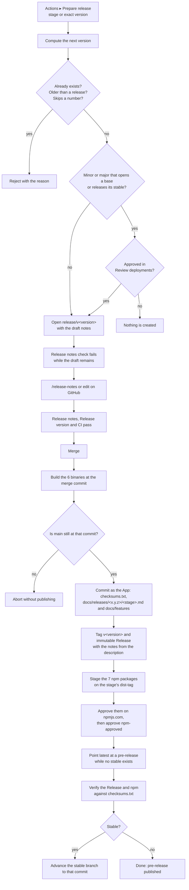

# Versioning

[Português](versioning.pt-br.md)

bcct uses one version number everywhere: the binary, the npm packages and the three plugins. Each version goes through pre-release stages until it reaches stable, and each release starts as a version pull request that a workflow opens. You pick the stage, review the notes in the pull request description, and merging publishes it.

## 🔢 The version number

The version is stored in 8 files, and all of them must match: `rust/Cargo.toml`, `rust/Cargo.lock`, both `package.json` files, `package-lock.json` and the three `plugin.json` files. `npm run release:version -- check` reports the file that doesn't match.

The format is `X.Y.Z` with an optional stage:

| Stage  | Example         | npm dist-tag | GitHub release |
| ------ | --------------- | ------------ | -------------- |
| alpha  | `0.3.0-alpha.2` | `alpha`      | pre-release    |
| beta   | `0.3.0-beta.1`  | `beta`       | pre-release    |
| rc     | `0.3.0-rc.1`    | `next`       | pre-release    |
| stable | `0.3.0`         | `latest`     | release        |

Until the first stable version, `latest` follows the newest pre-release, so `npx @pedromondek/better-claude-code-telegram` with no tag installs it. Once a stable version exists, `latest` stays with the stable versions.

## 🎯 Picking the next version

When you run **Prepare release**, choose a stage from the dropdown, or type an exact version. An exact version overrides the stage.

**From a pre-release**, the stage you choose decides:

| Current         | Choice   | Next            |
| --------------- | -------- | --------------- |
| `0.3.0-alpha.2` | `alpha`  | `0.3.0-alpha.3` |
| `0.3.0-alpha.2` | `beta`   | `0.3.0-beta.1`  |
| `0.3.0-alpha.2` | `rc`     | `0.3.0-rc.1`    |
| `0.3.0-alpha.2` | `stable` | `0.3.0`         |
| `0.3.0-beta.1`  | `alpha`  | rejected        |

You can skip stages (alpha straight to stable), but you can't go back.

**From a stable version**, git-cliff derives the number from the commits since the last release: `fix`, `perf` and `security` bump the patch (`0.2.0` → `0.2.1`), and a `feat` bumps the minor (`0.2.0` → `0.3.0`). The stage you choose sets the suffix: `alpha` gives `0.3.0-alpha.1`, and `stable` gives `0.3.0` directly. If there is no `feat`, `fix`, `perf` or `security` commit since the last release, there is nothing to release.

**An exact version** covers what the stage can't compute: the first release (`0.1.0-alpha.1`) and the next major (`1.0.0`). It must pass the same rules.

## 📏 The rules

Every new version, whether chosen by stage or typed in, must pass three rules:

1. **It must not exist yet.** No tag, published Release, npm version (deprecated ones included) or record in the repository (the notes in `docs/releases` and `plugins/telegram-hooks/checksums.txt`) can have this number. npm refuses to publish a number that was already used, even after an unpublish, and an immutable GitHub Release locks its tag name. A draft Release doesn't count: it creates no tag, is never published to npm and isn't immutable.
2. **It must be newer than every release.** It is higher than every released version under semver ordering, where a pre-release sorts before its stable (`0.3.0-rc.1` < `0.3.0`). You can't release `0.2.0-alpha.1` after `0.2.0`, or a hotfix `0.1.1` after `0.2.0`.
3. **It can't skip a number.** Each level goes up by one, and every level to its right resets to zero when a level to its left changes:

   | Last stable | Allowed                   | Not allowed      |
   | ----------- | ------------------------- | ---------------- |
   | `0.2.0`     | `0.2.1` (patch)           | `0.2.2`          |
   | `0.2.0`     | `0.3.0` (minor)           | `0.4.0`, `0.3.1` |
   | `0.2.0`     | `1.0.0` (major)           | `2.0.0`, `1.1.0` |
   | `1.4.2`     | `1.4.3`, `1.5.0`, `2.0.0` | `1.6.0`, `3.0.0` |

   Pre-releases follow the same rule: with `0.2.0` as the last stable, `0.3.0-alpha.1` is allowed and `0.4.0-alpha.1` isn't. Once a pre-release line is open, it stays on that base until it reaches stable: after `0.3.0-alpha.1`, the next base is `0.3.0` (another alpha, a beta, an rc or the stable), never `0.4.0`. A fix written against an older base ships on the newest one: if `0.3.0` was released while you were working on it, the fix ships as `0.3.1` or `0.4.0-alpha.1`.

A number counts as released if it shows up in any of the sources above. When the tags, the Releases and npm disagree (a deleted tag whose version is still on npm, or a Release without an npm package because the publish failed), the run prints a warning, and the number stays burned.

## ✋ When a version needs your approval

The **base** is the `X.Y.Z` part of a version: `0.3.0-beta.2` has the base `0.3.0`. A new base starts with the first version on it, at any stage (`0.3.0-alpha.1`, `0.3.0-beta.1` or `0.3.0` itself), and later versions stay on that base even when the stage changes.

The bump is measured against the last stable. A patch never needs approval. A minor or major needs approval twice: when it opens the base and when the base is released as stable.

| Last stable `0.2.0`               | Bump  | Needs approval?          |
| --------------------------------- | ----- | ------------------------ |
| `0.2.1` or `0.2.1-alpha.1`        | patch | no                       |
| `0.3.0-alpha.1` (opens the base)  | minor | yes                      |
| `0.3.0-alpha.2`, `beta.1`, `rc.1` | minor | no, the base is approved |
| `0.3.0` (stable release)          | minor | yes                      |
| `0.3.0` with no pre-release first | minor | yes, once                |
| `1.0.0-beta.1` (opens the base)   | major | yes                      |

The project's first release also opens a base, so it needs approval too.

The workflow only runs from `main` and has three jobs:

1. **Compute the version** works out the version, checks the rules and adds a table to the run summary: the highest released version (From), the new one (To), the bump (Bump) and what happens next (Next), which is either opening the pull request right away or waiting for your approval.
2. **Approve the minor or major** runs only when the version needs approval, and waits under **Review deployments** in the `release-approval` environment.
3. **Open the version pull request** runs when no approval was needed or once you approve. Rejecting creates no branch and no pull request.

## 🔀 The version pull request

The workflow opens the pull request `release/v<version>`, titled `Release v<version>`, with one commit that writes the version to the 8 files. Between `<!-- notes -->` and `<!-- /notes -->`, the description holds the layout of the notes: a `<!-- draft -->` line, the TIP with the Telegram channels, the IMPORTANT with the install commands, the IMPORTANT with the update commands, the legend NOTE, the English block (`<details><summary>` English) with the draft that git-cliff generates from the commits, and an empty Portuguese block:

```
<!-- notes -->
<!-- draft -->
> [!TIP]
> ...
<details><summary>🇺🇸 English</summary>

### Features
- ...

</details>
<details><summary>🇧🇷 Português</summary>

</details>
<!-- /notes -->
```

Everything between `<!-- notes -->` and `<!-- /notes -->` becomes the body of the Release. Write the final notes with `/release-notes`, which starts from the patch notes of the pull requests merged since the last tag (`npm run release:patch-notes`), drafts the public notes in en-us and pt-br and asks you to approve each part, or edit the description on GitHub and delete the `<!-- draft -->` line.

Two checks gate the pull request on every push and every edit of the description:

- **Release notes** fails while the `<!-- draft -->` line is still between the markers, while the notes are empty or lack the 🇧🇷 block, which the release needs to build `docs/features`, or when a marker is missing or repeated, so a raw draft never gets published.
- **Release version** re-checks the three rules, in case another version shipped while the pull request was open, and verifies that all 8 files carry the version in the branch name.

The workflow opens the pull request only once. To prepare the same version again, close the pull request and delete its branch.

## 🚀 What happens on merge



On merge, the release workflow:

1. Builds the 6 binaries (Linux, macOS and Windows, on x64 and arm64) at the merge commit and attests each one, and aborts if `main` has moved since.
2. Commits through the App `checksums.txt` (append-only), the notes in `docs/releases/<x.y.z>/<stage>.md` (`0.3.0-alpha.2` in `docs/releases/0.3.0/alpha.2.md`, the stable in `docs/releases/0.3.0/stable.md`) and the [feature docs](../features/features.md), which `npm run docs:features` rebuilds from the ✨ items of every release.
3. Creates the tag `v<version>` and the immutable Release at that commit, with the notes from the pull request description.
4. Stages the 7 npm packages through trusted publishing, on the stage's dist-tag. They stay private until the maintainer approves them on the Staged Packages tab of npmjs.com, all 7 with one 2FA challenge.
5. Waits in the `npm-approved` environment. npm sends no event when the packages are approved, so the maintainer approves the run too, after approving them on npm.
6. Points the `latest` dist-tag of the 7 packages at a pre-release while no stable version is on npm, through trusted publishing; it never moves `latest` back from a newer version. Each package needs the "Allow npm dist-tag" option of its trusted publisher, which only its settings on npmjs.com turn on.
7. Verifies the published version (`verify-release.yml`): the Release is immutable and carries exactly the binaries, their `.sha256` and `checksums.txt`; each binary passes `gh release verify-asset` and `gh attestation verify`; each npm package has the version on the stage's dist-tag, `latest` at the version or later while no stable version exists, a tarball that matches its integrity, the provenance of trusted publishing and the files of that commit; and `npm audit signatures` passes on an install for each of the 6 platforms.
8. For a stable release only, advances the `stable` branch to the verified commit. `stable` is the marketplace ref that the setup and `bcct update` register for a stable version; a pre-release registers its own tag, `v<version>`.

The release also runs by hand (Actions ▸ Release ▸ Run workflow) on a merged version pull request, for when the merge did not start it or a run stopped halfway. Until the Release is published, it picks up where the last run stopped: a record already on `main` or a draft Release is reused, not made again. Once the Release is published (a run that stopped at the npm stage, its approval, the `latest` step or the verify), a plain dispatch refuses it with `v<version> is already published`: re-run the failed jobs of that run instead, whose npm stage skips a package already on npm. With **only_latest** checked, the dispatch on a published version runs only the `latest` step and the verify, with no build, publish or announcement. When the run that published the version stopped before its announcement, run `announce-release.yml` by hand on the same pull request afterwards. `verify-release.yml` also runs alone, by hand, on a merged version pull request.

## ⌨ Commands

| Command                                            | What it does                                                                                                                                                                           |
| -------------------------------------------------- | -------------------------------------------------------------------------------------------------------------------------------------------------------------------------------------- |
| `npm run release:version -- check`                 | Reports the file whose version doesn't match                                                                                                                                           |
| `npm run release:version -- next <stage>`          | Shows the next version for that stage                                                                                                                                                  |
| `npm run release:version -- swap-stage`            | Writes the other stage of the current version (`0.2.0` becomes `0.2.0-alpha.1`, a pre-release becomes its stable base); the CI uses it to run the Rust tests on a binary of each stage |
| `npm run release:cliff -- --unreleased`            | Shows the draft notes since the last release                                                                                                                                           |
| `npm run release:pr -- plan <stage or version>`    | Computes the next version, checks the rules and reports the bump and whether it needs approval                                                                                         |
| `npm run release:pr -- prepare <stage or version>` | Checks again, writes the version on the `release/v<version>` branch and opens the pull request (the workflow runs it with the App token)                                               |
| `npm run release:pr -- check-version`              | Checks the version of the branch named in `PR_BRANCH`, as the Release version check does                                                                                               |
| `npm run release:pr -- check-notes`                | Checks the notes in the description held in `PR_BODY`, as the Release notes check does                                                                                                 |
| `/release-notes [<version>]`                       | Writes the public notes into the version pull request description                                                                                                                      |
