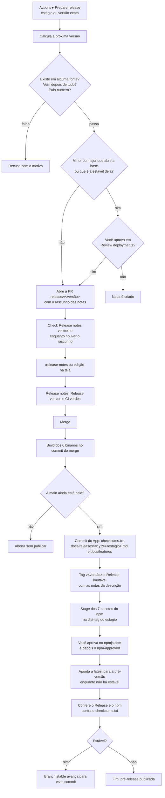

# Versionamento

[English](versioning.md)

O bcct tem uma versão só, a mesma no binário, nos pacotes npm e nos três plugins. Ela anda por estágios de teste até a estável, e cada versão sai de uma PR de versão aberta por um workflow: você escolhe o estágio, revisa as notas na descrição da PR, e o merge publica.

## 🔢 A versão

Ela fica em 8 arquivos, que sempre têm o mesmo número: `rust/Cargo.toml`, `rust/Cargo.lock`, os dois `package.json`, o `package-lock.json` e os três `plugin.json`. O `npm run release:version -- check` aponta o arquivo que divergir.

O formato é `X.Y.Z` com um estágio opcional:

| Estágio | Exemplo         | Dist-tag do npm | No GitHub   |
| ------- | --------------- | --------------- | ----------- |
| alpha   | `0.3.0-alpha.2` | `alpha`         | pre-release |
| beta    | `0.3.0-beta.1`  | `beta`          | pre-release |
| rc      | `0.3.0-rc.1`    | `next`          | pre-release |
| stable  | `0.3.0`         | `latest`        | release     |

Até a primeira versão estável, a `latest` acompanha a pré-versão mais nova, então o `npx @pedromondek/better-claude-code-telegram` sem tag instala ela. Depois que existe uma estável, a `latest` fica com as estáveis.

## 🎯 Como a próxima versão é escolhida

No disparo do **Prepare release** você escolhe o estágio num select e pode digitar uma versão exata, que vale no lugar dele.

**De uma pré-versão**, o estágio decide:

| Atual           | Escolha  | Próxima         |
| --------------- | -------- | --------------- |
| `0.3.0-alpha.2` | `alpha`  | `0.3.0-alpha.3` |
| `0.3.0-alpha.2` | `beta`   | `0.3.0-beta.1`  |
| `0.3.0-alpha.2` | `rc`     | `0.3.0-rc.1`    |
| `0.3.0-alpha.2` | `stable` | `0.3.0`         |
| `0.3.0-beta.1`  | `alpha`  | recusada        |

Pular estágio pode (alpha direto para stable); voltar não.

**De uma estável**, o número vem dos commits desde a última versão, pelo git-cliff: `fix`, `perf` e `security` sobem o patch (`0.2.0` → `0.2.1`), um `feat` sobe o minor (`0.2.0` → `0.3.0`). O estágio escolhido completa: `alpha` dá `0.3.0-alpha.1`, `stable` dá `0.3.0` direto. Sem nenhum `feat`, `fix`, `perf` ou `security` desde a última versão, não há o que lançar.

**A versão exata** serve para o que o estágio não calcula: a primeira versão (`0.1.0-alpha.1`) e o próximo major (`1.0.0`). Ela passa pelas mesmas regras.

## 📏 As regras

Toda versão nova, pelo estágio ou digitada, passa por três regras:

1. **Não existe.** Nenhuma tag, Release publicado, versão do npm (inclusive deprecada) ou registro do repositório (as notas em `docs/releases` e o `plugins/telegram-hooks/checksums.txt`) tem esse número. O npm recusa publicar um número já usado, mesmo depois do unpublish, e o Release imutável do GitHub trava o nome da tag. Um Release em rascunho não conta: ele não cria tag, não vai ao npm e não é imutável.
2. **Vem depois de tudo.** Ela é maior que todas as versões que já saíram, pela ordem do semver, em que a pré-versão vem antes da sua estável (`0.3.0-rc.1` < `0.3.0`). Não sai `0.2.0-alpha.1` depois da `0.2.0`, nem um hotfix `0.1.1` depois da `0.2.0`.
3. **Não pula número.** Cada nível sobe de um em um, e os da direita zeram quando um da esquerda muda:

   | Última estável | Pode                      | Não pode         |
   | -------------- | ------------------------- | ---------------- |
   | `0.2.0`        | `0.2.1` (patch)           | `0.2.2`          |
   | `0.2.0`        | `0.3.0` (minor)           | `0.4.0`, `0.3.1` |
   | `0.2.0`        | `1.0.0` (major)           | `2.0.0`, `1.1.0` |
   | `1.4.2`        | `1.4.3`, `1.5.0`, `2.0.0` | `1.6.0`, `3.0.0` |

   A pré-versão segue a mesma base: com a `0.2.0` como última estável, `0.3.0-alpha.1` pode e `0.4.0-alpha.1` não. Uma linha de pré-versão aberta segue até a sua estável: depois de `0.3.0-alpha.1`, a próxima base é `0.3.0` (mais alpha, beta, rc ou a estável), nunca `0.4.0`. Uma correção feita em cima de uma base antiga entra na base maior: se a `0.3.0` saiu enquanto ela era feita, ela sai como `0.3.1` ou `0.4.0-alpha.1`, conforme o caso.

"Tudo o que já saiu" é a união das fontes acima: basta o número estar em uma delas. Quando as tags, os Releases e o npm discordam (uma tag apagada com a versão no npm, um Release sem npm porque a publicação falhou), a execução avisa, e o número continua queimado.

## ✋ Quando a versão espera a sua aprovação

A **base** é a parte `X.Y.Z` da versão: `0.3.0-beta.2` tem a base `0.3.0`. Uma base nova abre com a primeira versão daquele número, em qualquer estágio (`0.3.0-alpha.1`, `0.3.0-beta.1` ou direto a `0.3.0`), e as seguintes andam dentro dela, mesmo trocando de estágio.

O salto é medido contra a última estável: um patch nunca para; um minor ou major para em dois momentos, quando abre a base e quando ela sai estável.

| Última estável `0.2.0`            | Salto | Para?                       |
| --------------------------------- | ----- | --------------------------- |
| `0.2.1` ou `0.2.1-alpha.1`        | patch | não                         |
| `0.3.0-alpha.1` (abre a base)     | minor | sim                         |
| `0.3.0-alpha.2`, `beta.1`, `rc.1` | minor | não, a base já foi aprovada |
| `0.3.0` (a estável da base)       | minor | sim                         |
| `0.3.0` direto, sem pré-versão    | minor | sim, uma vez só             |
| `1.0.0-beta.1` (abre a base)      | major | sim                         |

A primeira versão do projeto, sem nenhuma estável antes, também abre uma base e para.

O workflow só roda a partir da `main` e tem três jobs:

1. **Compute the version** calcula a versão, confere as regras e escreve no resumo da execução uma tabela com a maior versão já lançada (From), a nova (To), o salto (Bump) e o que vem a seguir (Next): abrir a PR direto ou esperar a sua aprovação.
2. **Approve the minor or major** só roda quando a versão precisa de aprovação, e espera em **Review deployments**, no environment `release-approval`.
3. **Open the version pull request** roda quando a aprovação não era necessária ou foi dada. Recusar não cria branch nem PR.

## 🔀 A PR de versão

O workflow abre a PR `release/v<versão>`, com o título `Release v<versão>` e um commit que grava a versão nos 8 arquivos. Entre `<!-- notes -->` e `<!-- /notes -->`, a descrição traz o layout das notas: uma linha `<!-- draft -->`, o TIP com os canais do Telegram, o IMPORTANT com os comandos de instalação, o IMPORTANT com os comandos de atualização, numa versão que junta outras o NOTE 📦 de inclusões com o link do Release de cada uma (a primeira beta junta as alphas da sua base, a primeira rc as betas, uma estável todas as pré-versões da sua base), o NOTE da legenda, o bloco em inglês (`<details><summary>` English) com o rascunho que o git-cliff gera a partir dos commits e um bloco em português vazio:

```
<!-- notes -->
<!-- draft -->
> [!TIP]
> ...
<details><summary>🇺🇸 English</summary>

### Features
- ...

</details>
<details><summary>🇧🇷 Português</summary>

</details>
<!-- /notes -->
```

O que fica entre `<!-- notes -->` e `<!-- /notes -->` é o corpo do Release. As notas finais entram pela `/release-notes`, que parte das patch notes das PRs mergeadas desde a última tag ou, numa versão que junta outras, desde a tag anterior à primeira que ela junta (`npm run release:patch-notes`), então a primeira beta traz as alphas e o que a beta mudou, e as betas seguintes só o que mudou desde a anterior, escreve as notas públicas em en-us e pt-br e aprova cada parte com você, ou editando a descrição na tela e apagando a linha `<!-- draft -->`.

Dois checks seguram a PR, a cada push e a cada edição da descrição:

- **Release notes** fica vermelho enquanto a linha `<!-- draft -->` estiver entre os marcadores, as notas estiverem vazias ou sem o bloco 🇧🇷, de que o release precisa para gerar o `docs/features`, ou os marcadores faltarem ou se repetirem, então o rascunho cru nunca é publicado.
- **Release version** confere de novo as três regras, para o caso de outra versão ter saído enquanto a PR estava aberta, e que os 8 arquivos têm a versão da branch.

A PR abre uma vez só. Para preparar de novo a mesma versão, feche a PR e apague a branch.

## 🚀 O merge publica



No merge, o release:

1. Constrói os 6 binários (Linux, macOS e Windows, x64 e arm64) no commit do merge e atesta cada um, e aborta se a `main` andou nesse meio-tempo.
2. Faz, pelo App, um commit com o `checksums.txt` (que só cresce), as notas em `docs/releases/<x.y.z>/<estágio>.md` (`0.3.0-alpha.2` em `docs/releases/0.3.0/alpha.2.md`, a estável em `docs/releases/0.3.0/stable.md`) e a [doc de funcionalidades](../features/features.pt-br.md), que o `npm run docs:features` refaz a partir dos itens ✨ de todas as versões.
3. Cria a tag `v<versão>` e o Release imutável nesse commit, com as notas da descrição da PR.
4. Põe em stage os 7 pacotes do npm, por trusted publishing, na dist-tag do estágio. Eles ficam privados até o mantenedor aprová-los na aba Staged Packages do npmjs.com, os 7 com um desafio de 2FA só.
5. Espera no environment `npm-approved`. O npm não manda evento quando os pacotes são aprovados, então o mantenedor aprova também a run, depois de aprovar no npm.
6. Aponta a dist-tag `latest` dos 7 pacotes para a pré-versão enquanto não há versão estável no npm, por trusted publishing; nunca leva a `latest` de volta de uma versão mais nova. Cada pacote precisa da opção "Allow npm dist-tag" do trusted publisher dele, que só as configurações do pacote no npmjs.com ligam.
7. Confere a versão publicada (`verify-release.yml`): o Release é imutável e traz exatamente os binários, os `.sha256` e o `checksums.txt`; cada binário passa no `gh release verify-asset` e no `gh attestation verify`; cada pacote do npm tem a versão na dist-tag do estágio, a `latest` nessa versão ou numa mais nova enquanto não há estável, um tarball que bate com a integridade dele, a proveniência do trusted publishing e os arquivos daquele commit; e o `npm audit signatures` passa numa instalação de cada uma das 6 plataformas.
8. Só numa estável, avança a branch `stable` para o commit conferido. A `stable` é a ref do marketplace que o setup e o `bcct update` registram numa versão estável; uma pre-release registra a própria tag, `v<versão>`.

O release também roda à mão (Actions ▸ Release ▸ Run workflow) numa PR de versão mergeada, para quando o merge não o disparou ou uma run parou no meio. Até o Release ser publicado, ele retoma de onde a última parou: o registro já na `main` e o rascunho do Release são reaproveitados, não refeitos. Com o Release já publicado (uma run que parou no stage do npm, na aprovação dele, no passo da `latest` ou na conferência), o disparo comum a recusa com `v<versão> is already published`: refaça os jobs que falharam daquela run, cujo stage do npm pula o pacote já no npm. Com o **only_latest** marcado, o disparo numa versão publicada roda só o passo da `latest` e a conferência, sem build, publicação nem anúncio. Quando a run que publicou a versão parou antes do anúncio, rode depois o `announce-release.yml` à mão na mesma PR. O `verify-release.yml` também roda sozinho, à mão, numa PR de versão mergeada.

## ⌨ Comandos

| Comando                                             | O que faz                                                                                                                                                                        |
| --------------------------------------------------- | -------------------------------------------------------------------------------------------------------------------------------------------------------------------------------- |
| `npm run release:version -- check`                  | Aponta o arquivo cuja versão diverge                                                                                                                                             |
| `npm run release:version -- next <estágio>`         | Mostra a próxima versão daquele estágio                                                                                                                                          |
| `npm run release:version -- swap-stage`             | Grava o outro estágio da versão atual (`0.2.0` vira `0.2.0-alpha.1`, e uma pre-release vira a base estável dela); o CI usa para rodar os testes Rust num binário de cada estágio |
| `npm run release:cliff -- --unreleased`             | Mostra o rascunho das notas desde a última versão                                                                                                                                |
| `npm run release:pr -- plan <estágio ou versão>`    | Calcula a próxima versão, confere as regras e diz o salto e se pede aprovação                                                                                                    |
| `npm run release:pr -- prepare <estágio ou versão>` | Confere de novo, grava a versão na branch `release/v<versão>` e abre a PR (é o que o workflow roda, com o token do App)                                                          |
| `npm run release:pr -- check-version`               | Confere a versão da branch em `PR_BRANCH`, como o check Release version                                                                                                          |
| `npm run release:pr -- check-notes`                 | Confere as notas da descrição em `PR_BODY`, como o check Release notes                                                                                                           |
| `/release-notes [<versão>]`                         | Escreve as notas públicas na descrição da PR de versão                                                                                                                           |
